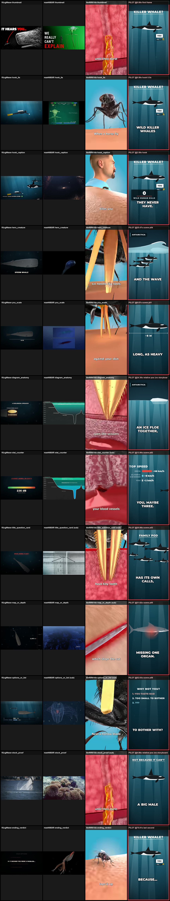
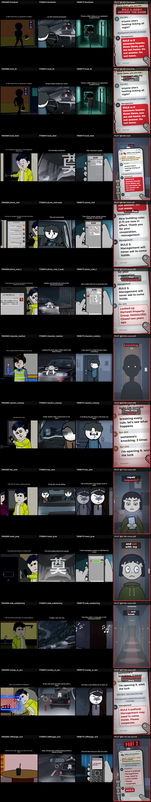
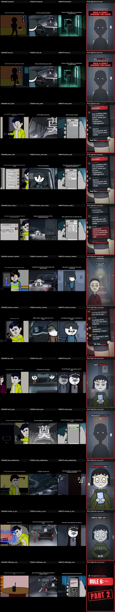

# Pilot QA: side-by-side review against the references

Written 2026-11-01 ~11:35 UTC from the review-round results of the QA workflow. Each round had two reviewers:
a **visual parity** reviewer (does it look like the `research/library/review-refs/<niche>/` references in a feed?) and a
**viewer / retention** reviewer (would a viewer watch to the end?). Sheets come from `scripts/side_by_side.sh`
(rows = shot classes, reference columns + pilot in the last column) and live in `out/qa/`.

Scores are given as each reviewer reported them. Most used /100; three used /10 (horror r1 visual 3/10, horror r2
visual 6/10, blue-whale r3 viewer 7/10). Where a round's two sheet files are byte-identical, the sheet is shown once.

| Pilot | Final 9:16 MP4 | Rounds | Last round (visual / viewer) | Verdict |
|---|---|---|---|---|
| explainer-orca | `out/pilots/explainer-orca/explainer-orca_9x16.mp4` (75.1 s) | 2 | 74 / 80 | **PASS** |
| horror-pinned-rules | `out/pilots/horror-pinned-rules/horror-pinned-rules_9x16.mp4` (65.2 s) | 3 | 72 (FAIL) / 82 (PASS) | **FAIL** |
| explainer-blue-whale | `out/pilots/explainer-blue-whale/explainer-blue-whale_9x16.mp4` (70.1 s) | 3 | 80 / 7 of 10 | **PASS** |

Each pilot folder holds the posting package: the 9:16 MP4 (+ 16:9 for the explainers), `thumbs/` (3 thumbnails in
9:16 and 16:9, plus `sheet_*.jpg`), `titles.md`, `description.md` (with AI-voice / altered-content disclosure steps), and
`references.md` (the cited viral references and the beat alignment table). See "Package" under each pilot.

---

## 1. explainer-orca (P-explainer): PASS

**Final MP4:** `/Users/patrickliu/Documents/faceless-studio/out/pilots/explainer-orca/explainer-orca_9x16.mp4`
(75.115 s, 1080x1920, md5 55793987…, commit 10b036c). The previous cut is kept as `explainer-orca_9x16-prev.mp4` (76.6 s,
md5 79ef71a5…, the cut reviewed in round 1).

| Round | MP4 reviewed | Visual parity | Viewer / retention | Round result |
|---|---|---|---|---|
| 1 | 76.6 s cut (now `-prev`) | 60/100 FAIL (close) | PASS (no score given; reported 78) | FAIL |
| 2 | 75.1 s cut, commit 10b036c (final) | 74/100 PASS | 80 PASS | **PASS** |

### Round 1 (60 / 78): FAIL

Visual parity, 60/100, FAIL (close)

What already works: the flat-vector look of the kit is in the same family as fGcgWaswMns (Depth Theory). The navy-to-teal
gradient with god rays is on spec (#0a1b23 top, #2c6070 mid, #0c1f28 bottom). Red is mostly kept for accents (BIGGEST, SUNK,
the struck option, the counter underline). Captions are 2-4 word heavy white caps with a shadow at y≈1380 (inside SAFE_AREA).
The ~8 M ruler with the cars and 6 TONNES (6-9 s), the Gansbaai map, the sailboat with the snapped rudder and the
KILLER WHALE? loop bookend at 76 s hold up next to the references. The thumbnails are strong and on brief.

Why it would still look amateur in a feed:
1. Frame 0 (the Shorts cover) is a quiet mid-shot: white KILLER WHALE? header, orca at ~30% scale, a ~60 px diver, no claim, no red.
2. Several holds are 60-80% empty water: 10-16 s (speed bars, orca a sliver, tiny YOU), 50-56 s (options list alone), 72-74 s, 24 s (empty iceberg).
3. Two "you" art styles: the white stick figure (8 s, 54 s) clashes with the vector diver.
4. The diver is 60-110 px long at 1080 wide, smaller than its own YOU tag.
5. Collisions: the 0 WILD HUMAN KILLS card covers the diver at 2.5 s; three stacked orcas in Antarctica (24-28 s); a YOU tag with no body at 28 s.
6. Five different header treatments; the refs use one rule (centred, red underline).
7. Caption cards end on dangling words (YOU'RE SCARED OF / MAYBE THEY / AND THIS SMART / WHAT CHANCE).

Camera and motion are adequate (zoom keyframes in every scene, something new every 2-3 s). Storyboard start times run 1-2 s
ahead of the 2 s scrub; a few frames don't match the storyboard order (sailboat at 62.5 s vs p11 at 62.0 s; the p09 harbour
seal not visible at 52/54 s). episodes/README.md listed the orca at 89.4 s; it was a 76.6 s cut.

Viewer / retention, PASS (78)

Checked 1 s frames for 0-5 s and 2 s after, ebur128 / silencedetect / scene detection on the Spark CPU (nice, 2-4 threads).
The Spark's own `studio/out/pilots/explainer-orca/explainer-orca_9x16.mp4` was a stale 89.4 s render; don't QA against it.

Verdict PASS. Hook lands: frame 0 shows the orca at ~74% width, a YOU diver and KILLER WHALE?; the 10-word paradox ends at
2.9 s; 0 WILD HUMAN KILLS arrives at ~2.0 s. Scene/layer changes at least every ~1.5 s, caption cards every 0.5-1.5 s, no hold
over 4 s. Escalation reads well; red only on threat words; last frame = frame 0 (loop bookend, no CTA, PLAYBOOK S7).
Captions word-synced (31 onsets checked, lead 10-130 ms, median ~70 ms). Audio -14.1 LUFS, TP -1.1 dBFS, LRA 1.7, no
clipping; bed ~19-20 dB under the voice (barely audible on phone speakers). 205 wpm (band 180-230); hook 10 words / 2.9 s;
re-hooks at 48%, 61%, 81%; "you" ~11/min (target 12-20). At 76 s it is longer than any corpus outlier (max 59 s).
Script cites 3 references with a beat table; originality_check PASS.

Weak spots: (1) ~1.4 s dead air at the loop seam; (2) p09 options beat (49.4-54.3 s) is ~5 s of a small list on empty navy at
the highest drop-off point; (3) header styling, p01 car over the scale label, unreadable Iberia map, caption split
"THEY CAN'T.", two sheet rows unmatched. Sheet committed (a0c196d).

### Round 2 (74 / 80): PASS

Visual parity, 74/100, PASS

Next to fGcgWaswMns (style target) the pilot holds up: same flat-vector navy-to-teal ocean with god rays, clean orca, great
white and blue whale art, heavy caps headers with a red underline, red as the only accent (the 0, LIVER, BIGGEST, RAMMING,
SUNK). Captions ~75 px bold white caps with outline at y≈1330-1460, as readable as Zack D's 6mRR91AbxjQ. Frame 0 is the cover
"0 HUMAN KILLS" (one red word) over a large orca and a small YOU diver; last frame bookends it; the thumbnails match the
reference thumbnail grammar. A new layer or cut every 1-3 s, camera punches throughout, no hold over 4 s.

Five localized defects keep it below the references:
1. p04 Antarctica (21.7-27.6 s): the seal is never drawn, so "WASHES THE SEAL" plays over an empty floe. Cause: in
   `pipeline/episodes/orca_pilot.py` ~l.230 the seal sets opacity only on its last keyframe, and `studio/src/core/anim.ts`
   `sample()` returns the first defined keyframe value (0) for all earlier t.
2. The dark "menace" orca silhouettes in p06 (36-38 s) and p08 (45.9-49 s), #0a2531/#08202b on #06121c-#0b1a22, are invisible: an empty dark screen with a tiny diver.
3. p11 Iberia map (64.6-65.5 s): "IBERIAN ORCAS" label collides with orca icons and rings; PORTUGAL chip overlaps a ring; peninsula hard to recognise at zoom 15.
4. p12: the "~7 BOATS SUNK SINCE 2020" card touches the caption.
5. p01: the four cars at 8-9 s are clipped by both frame edges after the 1.19x punch.

Minor: "IN THE WILD" is low-contrast grey-teal on teal; surface-split scenes have a band (~#60a1b4) lighter than the README's
#2a6a8a cap; the filled white YOU figure looks plainer than the diver art.

Viewer / retention, 80, PASS

75.1 s, commit 10b036c. Hook passes (frame 0 cover, 10 words in 2.9 s, red COULD KILL at 1 s; PLAYBOOK S1 and H6). Visual
change passes (10 fps frame-diff: no 2 s stretch without change). Caption sync passes (onsets +0.05 to +0.14 s, one +0.29 s at
9.8 s; captions match speech at 11 spot checks). Audio -14.0 LUFS, LRA 1.6, TP -1.2 dBTP, no clipping, bed 13.8 dB under the
voice, ducked 11 dB. 204 wpm; 12 "you" per minute (edge of 12-20); turnstile at 49% with a hard cut. Loop bookend, no CTA.
Script cites VtrcKTkhDHU, fGcgWaswMns, jw6bS-WL4F4 with a beat table; originality_check PASS. Matches fGcgWaswMns on the
review-ref rules.

Problems: headline/tag swaps crossfade into garbled double text at 43.1-43.4 s and 56.8-57.1 s (lighter at 59.0 s); the orca
shadow is invisible in the turnstile beat (36-38 s is YOU alone); the "3 SECONDS TO REACH YOU" card touches the caption at
17 s; an orphan "OF" on caption line 3 at 29 s. Risks: average sentence 7.7 words with many full stops (PLAYBOOK wants chained
clauses); 75 s is longer than any Short outlier in the corpus (28-59 s). Sheet committed (b1cdfea).

### What still falls short of the references (orca)

- **Missing seal in p04 (21.7-27.6 s)**: the caption says the wave washes the seal off, but no seal is drawn (keyframe opacity bug in `orca_pilot.py` / `anim.ts sample()`). This is the one story/visual mismatch.
- **Invisible "menace" orcas at 36-38 s and 45.9-49 s**: near-black on near-black; those beats read as an empty screen at the turnstile, the likeliest swipe point.
- **Text collisions**: the 3 SECONDS card (17 s) and the ~7 BOATS SUNK card (p12) touch the caption; the Iberia map labels collide (64.6-65.5 s).
- **Crossfade double text** at 43.1-43.4 s and 56.8-57.1 s; an orphan "OF" caption line at 29 s.
- **Framing**: the cars clip both edges at 8-9 s; the plain filled YOU figure next to the diver art.
- **Structure**: 75 s is longer than every corpus Short outlier (28-59 s); "you" density sits at the bottom of the band.
- **16:9 cut (new, rendered ~11:31 UTC on the Spark CPU, 72 s at concurrency 4 from the current storyboard)**: the frame-0 "0 HUMAN KILLS" header is cropped at the top edge by the cover push-in (the last frame is fine). Long-form uses the custom thumbnail, so this is cosmetic, but `pipeline/episodes/reformat.py` should clamp the push-in so headers stay in frame.

### Package (`out/pilots/explainer-orca/`)

| File | Status |
|---|---|
| `explainer-orca_9x16.mp4` | final, 75.1 s, 1080x1920 (round 2 PASS cut) |
| `explainer-orca_16x9.mp4` | re-rendered 2026-11-01 ~11:31 UTC on the Spark CPU from `storyboard_16x9.json` (reformat of the final 9:16 storyboard), 75.1 s, 1920x1080. The old 16:9 was the 76.6 s cut. |
| `thumbs/` | 3 thumbnails x 2 ratios: `explainer-orca_explainer-scale_*` (0 HUMAN KILLS), `explainer-orca_explainer-eye_*` (IT CHOSE NOT TO), `explainer-orca-b_explainer-scale_*` (WHY NOT YOU?) |
| `titles.md` | 5 titles mapped to reference patterns; pick #2 for Shorts/TikTok, #1 for 16:9 |
| `description.md` | Shorts + 16:9 copy, chapters re-timed to the 75.1 s cut, fact re-check list, disclosure steps |
| `references.md` | VtrcKTkhDHU (318.8x), fGcgWaswMns (14.65x), jw6bS-WL4F4 (1.43x) + beat alignment |

---

## 2. horror-pinned-rules (P-horror): FAIL

**Final MP4:** `/Users/patrickliu/Documents/faceless-studio/out/pilots/horror-pinned-rules/horror-pinned-rules_9x16.mp4`
(65.216 s, 1080x1920, md5 cbe798ad…). Round 3 reviewed the 65.2 s cut from commit 2be1192 (md5 ca79bba8…); the file now in
the folder is the later re-render from commit 6d050b5 (11:03 UTC), which only changed caption colour (red on emphasis words
only) and re-timed the storyboard to the shipped mix by ~20 ms. It was not re-reviewed; a 4-frame check at 0 / 8.5 / 61.5 /
65.1 s shows the same picture as round 3, with "ONLY ONE" still on the grin and the end card still faded.
The render itself was done by the parallel agent a0dbf06d2d06b5c22 (audio mix, kit, final render) on the Spark CPU.
`horror-pinned-rules_9x16-prev.mp4` (65.75 s) was copied back from `~/studio/archive/horror-pinned-rules-retired/`; it is
believed to be the round 2 cut but its frames were not checked. The 88.3 s S1 cut reviewed in round 1 is retired (archived on the Spark).

| Round | MP4 reviewed | Visual parity | Viewer / retention | Round result |
|---|---|---|---|---|
| 1 | 88.3 s S1 cut (`~/studio/app/studio/out/S1/horror-pinned-rules.mp4`, retired) | 3/10 FAIL | 48 FAIL | FAIL |
| 2 | 64.94 s fix-1 cut | 6/10 FAIL | 74 PASS | FAIL |
| 3 | 65.216 s fix-2 cut, commit 2be1192 | 72/100 FAIL | 82 PASS | **FAIL** |

The workflow's MP4 field for round 1 held a placeholder ("Waiting for monitor events.") and round 3's held the fixer's
report text; both reviewers resolved the real file themselves as described above.

### Round 1 (3/10 / 48): FAIL

Visual parity, 3/10, FAIL

Reviewed the 88.3 s render finished 09:48 UTC (pulled at the time to `out/pilots/horror-pinned-rules/horror-pinned-rules.mp4`, since retired).

Works: clean, readable phone-chat UI (bubble text larger than the refs, red alert bubbles read well); the peephole fisheye
ending, knock-shake and glitch beats are good ideas; the protagonist art is comparable to the stick-figure ref (7659677578365537569).

Fails: (1) frame 0 is fully black, and the 0.5 s hook frame is an empty dark chat; (2) one shot for 34 s: the same HandPhone over
blurred bedroom from 0 to 34 s and in 9 of 14 scenes, while the refs alternate phone insert, reaction, set and prop insert every
few seconds; (3) far too dark: mean luma 24-38 vs the refs' 50-150 (median ~90); (4) Nora is a small head cut off in the corner
under an empty door (p09/p10); (5) the camera push-in moves the phone into the caption (p04, p07); (6) "ONLY ONE" covers the
neighbour's eyes and mouth at the payoff; (7) the peephole face reads neutral and friendly; (8) crude sausage-finger hand;
(9) no establishing shot, two-shot or prop insert. Full-bleed 9:16 with bold 3-word chunks is an acceptable house style only if subjects fill the frame.

Viewer / retention, 48, FAIL

88.34 s, 30 fps; frames, ebur128, silencedetect and scene detection on the Spark CPU (nice, 2 threads).

Passes: spoken hook "Rule four said..." runs 0.53-3.6 s with a knock at 1.95 s; captions within ±66 ms of 15 voice onsets;
-14.0 LUFS, TP -1.5 dBTP, LRA 3.5, music 6.5 dB ducked under the voice; 3 references with a beat table, originality PASS;
the scariest image (peephole, 68 s, 77%) and twist ("only one", 84 s, 95%) sit where the PLAYBOOK wants them.

Fails: black cover frame (0.2 s fade-in) and an empty phone to 0.57 s; one composition for 34 s with the top ~60% empty, a
new bubble only every 3-7 s and the thumb covering the newest bubble; the trusted source is contradicted at 27-31 s (35%)
instead of by 11 s; 163 wpm against 230-270, with 13 paragraph gaps of ~1.3 s (~17 s of low-energy air); static stretches
over 3 s (6-12, 61-68, 73-80, 84.4-88.3 s); no Part 2 card or bookend; Nora on screen only ~16 s and no two-shot.
Most viewers would leave in the 10-30 s phone stretch.

### Round 2 (6/10 / 74): FAIL

Visual parity, 6/10, FAIL

Clearly better than round 1: clean flat art with thick outlines, desaturated blue-grey night with one red accent, readable chat
(40-55 px bubbles). The door silhouette (~28 s) and peephole grin (~62 s) hold up next to the refs; RULE 6: typing + PART 2
works as a cliffhanger.

Still amateur: (1) every 2-3 word caption page wraps into a stacked 2-line pill (a `captions.tsx` layout bug), and captions at
y≈0.16 sit on top of white chat bubbles in ~8 of 33 samples, as mute-illegible fragments ("on and break", "There was only",
"C checked."); the refs use one clean 6-9 word line in a dark band. (2) The phone dominates: chat fills the frame in ~55% of
samples (cap 45%), punch-ins crop bubbles at the edges, and the cover is a text-only chat close-up under a translucent neon
banner, while all three refs open on a threat figure. Smaller: grey bone-like hand; four near-identical medium shots 40-48 s;
stray "ONLY ONE" on the peephole. Side note: voice 65.754 s vs video 64.95 s (last word ends 62.15 s, probably harmless).

Viewer / retention, 74, PASS

64.94 s. Hook lands by 1-3 s (red RULE 4 bubble at frame 0, line spoken by 3.3 s, knock + shake on "knocks" at 1.76 s);
longest hold 0-3.3 s (with a zoom), others ≤2.2 s (123 cuts/punches); a new jolt at least every ~6 s; turn at ~50% (grey dot
32.5 s); ending per PLAYBOOK §4C type 2 (RULE 6 from a new authority + PART 2, bookends the phone shot, no CTA). Captions
offset a constant ~+0.06 s. -14.0 LUFS, TP -1.5 dBTP, LRA 2.2, ~4.8 dB ducking. 3 references + beat table, originality PASS.

Holding it back: caption pills over chat text in ~8 places; the "terrified" face reads as a laughing grin at 4 beats; authority
contradicted at 12.4 s on screen / 14.8 s in speech (targets ≤11-12 s); 31 words in the first 10 s (median 43.5), ~193 wpm vs
230-270; 3-word caption fragments that split names and the payoff line; no physical threat on the cover; phone ~53% of screen
time (guidance 10-45%); the scariest image held only ~1.9 s.

### Round 3 (72 / 82): FAIL (visual parity)

Fix round 2 (what went in): one-line captions that shrink type to ≤76% instead of wrapping, per-scene caption height
(`captionY` / `captionYAt`), page breaks never before a unit letter or number or after "only" (commit 3dda10c); frame 0 =
silhouette at the door with RULE 4 on an opaque plate; chat punch-ins at zoom 1.22 with the whole bubble in frame and the
caption dropped to y≈0.75; reaction cuts, the Ben-at-5A hallway plant, the light-switch insert, the ECU / door / terrified
sequence; grin held longer, 0.2 s glitch (builder, b5c44fb); new terrified mouth, skin-tone rounded hand, opaque neon plate
(kit); tightened script, voice from 0.1 s, louder dread bed, contradiction at ~10-11 s (audio). The fixer flagged two leftovers
in the other agent's lane: the "inside. Dev in Six-C checked." page at ~9.5 s and "ONLY ONE" on the grin.

Visual parity, 72/100, FAIL

65.216 s, md5 ca79bba8, commit 2be1192; scrubbed every 2 s plus every 0.5 s over 35-64 s.

At parity: frame 0 is a real cover (silhouette under an opaque red RULE 4 plate, no black frame); desaturated blue-grey with
red as the only danger accent; flat outlined cast with expression swaps, cleaner than the mraevq/udhwkz panels; "Hartwell
Property Group. DISSOLVED." on screen at 10 s; ~50 px chat in punch-ins, high-contrast dark theme, chat ~40% of runtime;
real shot variety (ECU 40.5 s, 5A hallway plant 18 s, peephole 46-59 s, red-lit grin 60.5 s); one-line captions ~3% of frame
height on a dark pill in the top band, like the refs.

Why it still fails:
1. "ONLY ONE" is still burned onto the grin's chin from 60.5 to 63.5 s, though the reviewer asked to drop it.
2. The caption page "inside. Dev in Six-C checked." runs across a sentence and scene break at 8-9.5 s (core paginate bug).
3. About a dozen pages end on a dangling function word ("Rule four said if", "Rule five: Management will", "So who'd been answering our", "Management may", "hallway light and sat", "We just need to come", "A calm voice said", "I looked through", "His little green").
4. Every chat punch-in (6, 8, 10, 28, 32, 52-56 s) slices a half-visible text row across the top edge; it reads as a cropping error.
5. The light-switch insert (35-37 s) is three flat rects on a grey wall, no hand, no light change: a placeholder.
6. The last frame (65.1 s) is the RULE 6 / PART 2 card faded to ~40%: an outro fade, not a hard cliffhanger cut.

Smaller: the thumb overlaps the low-band caption (6, 10, 28 s); caption + RULE 4 plate stack two text blocks in the top 25% at
0.5 s; 41.4-44.3 s is a static door with no caption or visible knock shake; the same couch medium shot repeats 5 times (4, 12,
14, 16, 34 s); no two-shot. All six main fixes are targeted edits; only the switch insert needs new kit art.

Viewer / retention, 82, PASS

65.216 s, md5 ca79bba8. Sheet built on the Mac with `side_by_side.sh <mp4> horror --storyboard ...`; all other ffmpeg niced on
the Spark CPU. Heads-up: the Spark copy at `~/studio/app/studio/out/pilots/horror-pinned-rules/horror-pinned-rules_9x16.mp4`
is an older 64.94 s file.

Hook passes: frame 0 cover (silhouette + "RULE 4: DON'T ANSWER THE DOOR"), no fade; voice at 0.10 s, knock at 0.99 s, rule
line spoken by 2.2 s, first cut at 1.83 s; contradiction "Management shut down two years ago" at 9.6-10.8 s (inside 11 s).
Visual change passes: cuts/punches never more than ~2.6 s apart (longest holds 5.6-8.07, 16.3-18.8, 41.43-44.07 s with no
voice or caption, and the end card from 63.2 s). Captions word-synced at 6 spot checks, one line, change every ~1.4-2 s.
Audio: I -14.0 LUFS, LRA 6.0, TP -1.3, no clipping, bed 14 dB under the voice; silence only in the last 0.86 s. Something new
goes wrong about every 5 s; the grin is held ~3.5 s (target 4). ~194 wpm vs 230-270 (not a blocker at 65 s). Ending RULE 6 +
PART 2, no spoken CTA. 3 references (63.1x, 10.8x, 31x) with a beat table; originality PASS. No two-shot; the dark chat theme
differs from the README's light-UI note but was a deliberate call in b5c44fb.

Both flagged leftovers confirmed: the "inside. Dev in Six-C checked." page (7.40-~9.6 s) comes from the core caption code
(`studio/src/core/captions.tsx:104`, 3dda10c), not the other agent's builder; "ONLY ONE" (≈60-63 s) comes from
`pipeline/episodes/horror_eps.py:525-526` (b5c44fb).

### What still falls short of the references (horror)

- **"ONLY ONE" burned onto the grin (≈60-63.5 s)**: still present in the current file (checked at 61.5 s). Remove the RedText at `pipeline/episodes/horror_eps.py:525-526`; the refs never put text over the scare face.
- **Caption pagination**: a page that runs across a sentence and scene break ("inside. Dev in Six-C checked.", `captions.tsx:104`) and ~12 pages that end on a dangling function word. The refs show whole one-line subtitles.
- **Punch-in cropping**: every chat punch-in slices a half row of text at the top edge.
- **Placeholder light-switch insert (35-37 s)** with no hand or light change; a static, captionless door at 41.4-44.3 s; the same couch medium shot five times; no two-shot.
- **Ending**: the RULE 6 / PART 2 card fades to ~40% (still the case at 65.1 s in the current file); the refs hard-cut on the cliffhanger.
- **Pace**: ~194 wpm against the PLAYBOOK's 230-270 for narrated stories.
- **Review gap**: the current file (6d050b5 re-render) was not re-reviewed; only the caption colour changed.

Status: the viewer reviewer would let it run (82, PASS), but visual parity failed three times, so it is **not cleared to post**
until fixes 1-6 of round 3 land and a round 4 passes. The package is complete so it can go out as soon as that happens.

### Package (`out/pilots/horror-pinned-rules/`)

| File | Status |
|---|---|
| `horror-pinned-rules_9x16.mp4` | current cut, 65.2 s, 1080x1920 (6d050b5 re-render of the round 3 cut). Horror is 9:16 only. |
| `thumbs/` | 3 thumbnails x 2 ratios: `_horror-chat_*` (RULE 4: DON'T ANSWER THE DOOR), `_horror-door_*` (THREE KNOCKS), `_horror-hallway_*` (WHO PINNED THIS?); spare `horror-pinned-rules-door_horror-door_*` (WHO WROTE RULE 4?) |
| `titles.md` | 5 titles; pick #2 for TikTok/Shorts, #1 as the YouTube series title. Thumbnail pairings corrected to the rendered thumbnail text. |
| `description.md` | TikTok/Shorts copy, fiction + synthetic-voice line, disclosure steps |
| `references.md` | 7702661541224566049 (63.13x), 7659677578365537569 (10.79x), cVUJmsVkUW4 (30.95x) + beat alignment |

---

## 3. explainer-blue-whale (pilot 3): PASS

**Final MP4:** `/Users/patrickliu/Documents/faceless-studio/out/pilots/explainer-blue-whale/explainer-blue-whale_9x16.mp4`
(70.08 s, 1080x1920, md5 d859720c…). `explainer-blue-whale_9x16-prev.mp4` is the 72.9 s cut reviewed in round 2.

| Round | MP4 reviewed | Visual parity | Viewer / retention | Round result |
|---|---|---|---|---|
| 1 | 86.6 s cut | 58/100 FAIL | 58 FAIL | FAIL |
| 2 | 72.9 s cut (now `-prev`) | 74/100 FAIL | 68 FAIL | FAIL |
| 3 | 70.08 s cut (final) | 80/100 PASS | 7/10 PASS | **PASS** |

### Round 1 (58 / 58): FAIL

Visual parity, 58/100, FAIL

Good parts close to fGcgWaswMns: ocean gradient on spec (#28697c → #06202c, god rays, particles), clean flat whale and diver,
captions inside the safe area (y 0.72, size 84), hook and ending share the whale + YOU shot, strong thumbnails.

Amateur in a feed: (1) red everywhere: karaoke red on function words (AND, THAT'S, JUST, MUCH), red stats, an emoji heart, red X,
red sub-headlines; (2) caption pages end mid-phrase ("THAT'S TWO AND", "MUCH AS AN", "PARKED NOSE TO"); (3) clip-art beats: an
emoji heart with no golf cart (p04), an elephant floating with no tongue (p03), a white stick figure next to a beach ball with no
throat (p08); (4) poor use of 9:16: the whale a ~5%-tall sliver in p01/p02/p05/p06, bottom 30-40% empty, a featureless band
in p09; (5) low motion: no camera move in p03/p05/p06/p08, holds over 4 s (30.7-35.2, 41.2-45.4, 50.0-54.1, 78.4-82.6 s),
cuts every 5-10 s vs ~1.5 s on the 9:16 ref; (6) frame 0 has no text or YOU, and the last frame fades to black; (7) tags too
small for a phone (32-38 px), headers echo the caption. Sheet rows: thumbnail/cover fail; hook weak; anatomy and title card fail
(elephant, no tongue); stat and hero borderline; options and stock_proof fail; ending passes on content but ends black.

Viewer / retention, 58, FAIL

86.6 s, 47 frames. Style matches fGcgWaswMns; frame 0 not black; captions word-synced at 6 points; 2-4 word cards at y≈1280;
-14.1 LUFS, TP -1.1; originality PASS with 3 references.

Fails: a 19-word hook with the paradox at 5.8 s (target ≤12 words in ~3 s); ~157 wpm at TTS speed 0.96 with ~1 s dead pauses;
holds over 4 s (heart 31-37 s with no golf cart, throat gauge 66.5-70.5, bookend 78.4-82.5, weight 21-24.6); only 0.3 s
fades, no hard cuts; turnstile at 63% (target 45-55%); the throat scene swaps the diver for a stick figure and the red X sits on
the beach ball; a spoken comment CTA and a 0.5 s fade-out that breaks the loop; red on every caption; music inaudible
(-45.6 dBFS under the voice).

### Round 2 (74 / 68): FAIL

Visual parity, 74/100, FAIL

72.9 s. Matches the Depth Theory style: flat whale, navy-to-teal with god rays, red on threat words, drawn animated numbers
(≈190 t balance, 188 dB vs a jet, 40,000,000 krill counter, 2 BPM ECG); frame 0 not black with YOU in the mouth; last frame =
frame 0; punch-ins every ~1.5-2.5 s; captions at y≈1382.

Fails: (1) caption paging: 86 cards in 73 s (~0.85 s each), many orphan words or split numbers ("CART.", "close to two | hundred
tonnes", "as a beach | ball."); the 6mRR ref always shows phrase-complete cards; (2) under-filled or broken compositions:
near-black frame with a tiny heart (25-28 s), a flat black whale slab (42-44 s), the throat close-up with a slate band, diver
off-frame and the ball above the ring (51-57 s), a whale sliver (58-60 s), a thin vertical whale alone (4-7 s); (3) a weak cover:
78 px "FITS IN ITS MOUTH", no red word, restates the title; (4) the chosen thumbnail "YOU FIT INSIDE" repeats the title (ROOM
TO SPARE is the strongest). Minor: the 30 M chip over the ruler's own "30"; caption on the ruler's 0 tick; an all-red header.

Viewer / retention, 68, FAIL

72.9 s. Passes: word sync (28 onsets within ±0.17 s), mix (-14.0 LUFS, TP -1.1, music ~13 LU under the voice), loop ending
with no CTA, 3 references + originality PASS, frame 0 cover, no 3 s window without a visual change (hard cuts at 4.6 ... 66.6 s).

Fails: dead air (first word at 0.575 s, ten 0.6-0.74 s paragraph gaps ≈4.5 s; paradox lands at 4.13 s vs ≤3 s); a "tongue /
heart / call" fact list with zero "you" from 4.8 to 41 s (4.2 you/min vs 12-20), the likely swipe zone; turnstile at 56%, peak
at 79%, a redundant second re-hook, stinger ending on "there"; weak frames (half-drawn ECG and tiny heart at 26 s; krill with
no whale at 34.8-36.5 s; throat set not full-bleed with seams at 51-57 s; diver alone at 57.3-59.3 s; a fish-like vertical tail
at ~65.5 s); split number/compound pages ("CLOSE TO TWO | HUNDRED TONNES", "AS A BEACH | BALL.").

### Round 3 (80 / 7 of 10): PASS

Visual parity, 80/100, PASS

At least as good as the Depth Theory target (fGcgWaswMns) and a better use of 9:16 than either 16:9 ref. Frame 0 is a cover
(heavy-caps headline with red EAT, red arrow, open-mouthed whale, tiny YOU inside), repeated exactly at 69.3 s. Navy-to-teal
with god rays, never black; red only on the threat word, arrow and stat underlines. Every number drawn next to a familiar
object (buses on a ruler, balance with a sauropod and an elephant, heart vs golf cart, ECG, jet, krill counter, throat vs beach
ball). 84 px heavy white captions at y≈0.72, 2-4 words. Something new every 1-3 s, no hold over 4 s; full-bleed changes keep
the energy up. Strong thumbnails.

Still unpolished: (1) text blocks collide in the lower-middle band (tags/stats at y 60-64% sit on the y 72% caption; the 12 s
headline runs into the bus); (2) two tails on screen in p09 at 63 s; (3) the p03 "forty of you" crowd and the p01 diver are too
small to read on a phone; (4) in p04 the heart and golf cart are pushed to the edges and the diver/YOU overlap the cart.
None would look amateur in a feed; 1-3 are cheap scene-builder edits.

Viewer / retention, 7/10, PASS

70.08 s. Hook: frame 0 cover (YOU'RE TOO BIG TO EAT, red EAT, YOU in a gape ~75% of width); narration from 0.10 s; both halves of
the 12-word paradox done by 3.63 s. Picture change every 0.5-2.5 s (quieter but moving 27.4-35.3 s). Captions match speech at
36 sampled times; sentence-gap dips within 0.0-0.2 s of the storyboard except 30.44 s (heartbeat SFX) and 49.08 s (0.28 s
early). I -14.1 LUFS, LRA 1.5, TP -1.1, no clipping, music ~18 dB under the voice. 225 words in 69.7 s = 194 wpm; gaps 0.12-0.19 s.
Stinger ends at 69.39 s, last frame = frame 0, no CTA (PLAYBOOK S7). References jw6bS-WL4F4, JkAcCdqYJN0, fGcgWaswMns with
a beat table; originality PASS. Matches the review-refs README rules.

Defects: (1) both SFX land a sentence late: the heartbeat (30.49 s, 4.39 s) plays over the CALL scene, the whoosh (63.89 s)
over the bookend line; (2) a separate FLUKE svg overlaps the whale's own tail at ~62.5-63.8 s (two tails); (3) in p05 the far YOU
chip and a ~2 px diver are jammed against the 188 dB card; (4) p03 opens on an empty tilted balance for ~0.3 s (19.0 s); (5) some
pages run 5-6 words; (6) script: turnstile at 59% (target 45-55%), only 39% of sentences contain "you" (target ≥60%), and rungs
2-6 are sideways size facts, so 15-40 s is the likeliest swipe zone.

### What still falls short of the references (blue whale)

- **Mid-video sag (15-40 s)**: length / weight / tongue / heart / call are sideways size facts with little "you" (39% of sentences vs ≥60%); the turnstile sits at 59%.
- **SFX one sentence late**: heartbeat over the call scene (30.5 s), whoosh over the bookend line (63.9 s).
- **Two tails at the climax (≈62.5-63.8 s)**: the separate FLUKE svg overlaps the whale's own tail.
- **Lower-middle text collisions**: tags/stats at y 60-64% on the y 72% caption; the 12 s headline into the bus; the p05 YOU chip and ~2 px diver jammed on the 188 dB card.
- **Too small for a phone**: the "forty of you" crowd (p03) and the p01 diver; the heart and golf cart pushed to the frame edges (p04); an empty tilted balance for 0.3 s at 19.0 s.
- **Caption pages of 5-6 words** in places, against the refs' 2-4.
- **16:9 cut** (6-frame check): at ~8 s the "30 M" chip runs into the "HOW BIG IS IT?" header and the vertical ruler leaves both sides of the 16:9 frame empty; the two-tails defect is visible at 63 s too. It was re-rendered today from the current kit code; the 9:16 was rendered at ~10:49 UTC, before the caption-pager commit 1360749, so 16:9 caption pages can differ slightly from the 9:16.

### Package (`out/pilots/explainer-blue-whale/`)

| File | Status |
|---|---|
| `explainer-blue-whale_9x16.mp4` | final, 70.08 s, 1080x1920 (round 3 PASS cut) |
| `explainer-blue-whale_16x9.mp4` | re-rendered 2026-11-01 ~11:33 UTC on the Spark CPU from `storyboard_16x9.json` (reformat of the final 9:16 storyboard), 70.08 s, 1920x1080. The old 16:9 was the 86.6 s round 1 cut. |
| `thumbs/` | 3 thumbnails x 2 ratios: `explainer-blue-whale_explainer-eye_*` (ROOM TO SPARE, primary), `explainer-blue-whale-b_explainer-eye_*` (IT CAN'T SWALLOW YOU), `explainer-blue-whale_explainer-scale_*` (TOO BIG TO EAT) |
| `titles.md` | 7 titles mapped to reference patterns; pick #1 for Shorts/TikTok, #2 for 16:9 |
| `description.md` | Shorts + 16:9 copy, chapters re-timed to the 70.1 s cut, sources, pinned-comment CTA, disclosure steps |
| `references.md` | jw6bS-WL4F4 (1.43x), JkAcCdqYJN0 (15.82x), fGcgWaswMns (14.65x) + beat alignment |

---

## Notes for whoever posts

- **Disclosure:** `research/R5/` is empty, so each `description.md` carries working guidance: YouTube "Altered content" = Yes
  (realistic synthetic narrator), TikTok "AI-generated content" label on, plus a plain-text synthetic-voice line. Re-check the platform pages on publish day.
- **MP4s are not in git** (25-40 MB each, local only under `out/pilots/<slug>/`). Text files, thumbnails and QA sheets are committed.
- **Fact checks before publishing:** `episodes/explainer-orca/script.md` (the "~7 boats sunk" count) and `episodes/explainer-blue-whale/script.md` "Facts to verify".
- `episodes/README.md` lengths updated to the shipped cuts (orca 75.1 s, blue whale 70.1 s, horror 65.2 s).
