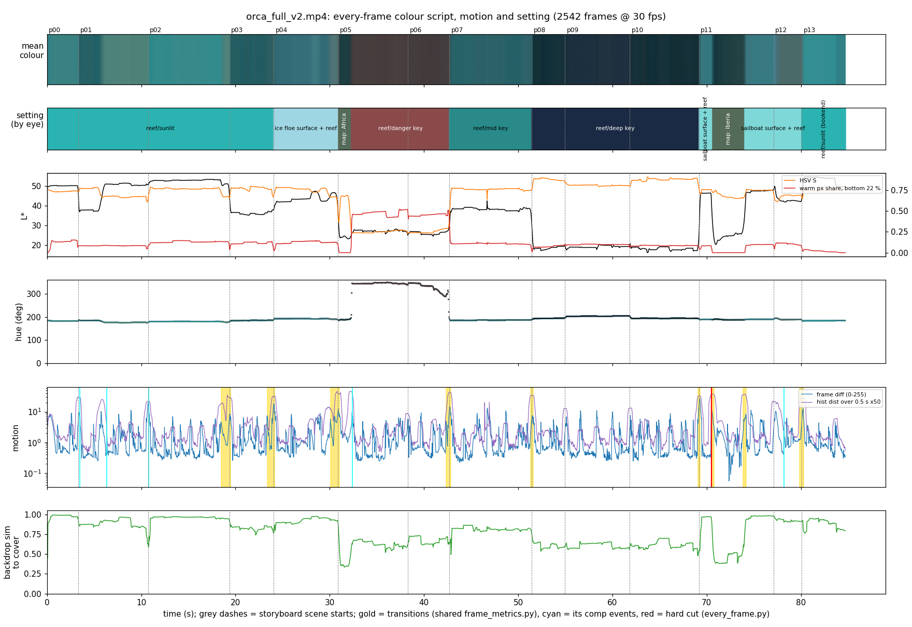

# Orca v2 audit: settings, set dressing and logical consistency

Video: `out/lantern/orca_full_v2.mp4` (1080x1920, 30 fps, 2,542 frames, 84.73 s), the orca pilot in the Lantern & Ink house style.
Inputs: `episodes/explainer-orca/storyboard.json` (14 scenes p00-p13), `episodes/explainer-orca/script.md`, FEEDBACK.md log 2026-11-01 (owner on v2 at 0:22-0:24: "logical consistency" and "switch scenery more").

**Verdict.** The video has one set. The same procedurally seeded tropical-reef stack sits under 14 of 14 scenes and is on screen in about 95 % of the frames (it is hidden only by the two map cards, about 3.9 s in total). With the reef come kelp, three jellyfish and a far pod of flat silhouettes that read as sharks. The places the narration names (Antarctica, South Africa, Western Australia, Spain and Portugal) change only the colour key and a prop at the waterline. Every scene breaks at least one location, depth, climate or lighting rule. All of it traces to one function, `env_set()` in `pipeline/episodes/house.py`, which never looks at where the scene is.

## 1. Every-frame metrics

Each of the 2,542 frames was decoded at its native rate, with no resampling, on the Spark CPU (`CUDA_VISIBLE_DEVICES=""`, `nice -n 10`, 6 threads). Two tools ran:

- `tools/frame_metrics.py` is the shared detector from the parallel reference study. It reports cuts, flashes, transitions, composition events and shots, and was run unchanged, so these numbers compare directly with the reference videos. Output: `data/orca_v2_shared_events.json`.
- `tools/every_frame.py` is new for this audit. It reports per-frame mean Lab, saturation-weighted hue, saturation and value, the warm-pixel share (whole frame and bottom 22 %), the 0.5 s histogram distance, a layout grid change, and a backdrop signature (bottom band plus side strips) compared against the cover. It also gives per-scene statistics. Its hard-cut rule is the same one used in `kurz-tools/motion_cuts.py`. Output: `data/orca_v2_frames.csv` (one row per frame) and `data/orca_v2_events.json`.

`tools/sample_frames.py` made the stills: every 0.5 s, plus 3 frames before and after every scene boundary, cut and transition (236 frames). They are on the contact sheets `sheets/orca_v2_every0.5s_00..09.jpg`.

| Metric | orca v2 | Reference (preliminary, parallel study, same tool) |
|---|---|---|
| Hard cuts | **0** (shared tool); 1 with the motion_cuts rule, at 70.50 s (the Iberia map card snapping in) | Kurzgesagt PaErPyEnDvk 0.44/min, 1AElONvi9WQ 0/min; fGcgWaswMns 5.8/min |
| Gradual transitions | 9 (shared tool, threshold TR_G 38). every_frame.py finds 16 at a lower threshold: all 13 scene boundaries plus 3 in-scene card swaps | — |
| Shots (between cuts/transitions) | 10; mean 8.47 s, **median 6.52 s**, p10 3.21, p90 17.88, max 19.5 (0:00-0:19.5) | median 6.28 / 3.65 / 5.77 s |
| Storyboard scenes | 14; mean 6.05 s, median 6.86 s (2.99-8.73) | — |
| Composition events | 5 (3.5/min, shared tool, 1 s window) | — |
| Gap between visual events, median | **4.25 s** | 2.23 / 1.77 / 4.10 s |
| Frame-difference energy, p5/25/50/75/95 | 0.30 / 0.43 / 0.75 / 1.94 / 6.22 (0-255 luma) | — |
| Low-motion frames (d < 0.5) | 33 % (static < 0.15: 0.2 %) | — |
| Hue family per 0.5 s | **teal 80 %**, blue 8 %, warm 10 % (all of it p05-p06, the "danger" key), violet 2 % | — |

**Transitions that are not visible changes.** Six of the 13 scene boundaries fall below the shared detector's full-frame transition threshold: 3.33 (wipe), 10.72 (whip), 38.27 (iris), 54.95 (wipe), 61.84 (wipe) and 77.09 (fade). These wipes and whips replace a scene with nearly the same picture: same reef, same kelp, same jellies, same palette. The detector agrees with the owner that the scenery does not change.

**Colour script** (`sheets/orca_v2_colour_script.png`, every frame). Teal at hue 180-205° holds from 0:00 to 0:31 and again from 0:43 to the end. The only hue departure is the coral "danger" key at 0:32-0:43 (hue about 340°). Luminance makes three steps: sunlit (L about 50) at 0:00-0:31, the dark "danger" and "deep" keys (L 18-27) at 0:31-0:43 and 0:51-1:09, and sunlit again from 1:09. Backdrop similarity to the cover stays at 0.8-0.98 in every sunlit scene and drops only when the key darkens or a map covers the frame.



## 2. Setting catalogue

I checked every boundary frame plus a frame every 0.5 s by eye (contact sheets). Settings are listed in the order they appear.

| # | Setting as seen | Holds | Scenes | What the narration says there | Motivated? |
|---|---|---|---|---|---|
| A | Underwater tropical reef in a sunlit teal key: coral strip, kelp, spires, jellies, far "sharks", fish school | 0:00.0-0:24.0 (24.0 s) | p00-p03 | hook, size, speed, "a pod hunts as a team" | **No.** No place is named; the right setting is open water. Coral is wrong for orcas, and coral never grows beside kelp. |
| B | Waterline with a night sky, ice floe and seal; the same reef, kelp, jellies and "sharks" below and above the water | 0:24.0-0:30.9 (6.9 s) | p04 | "In Antarctica, a pod charges an ice floe…" | **Partly.** The ice floe and seal fit. The reef, kelp, night sky, warm glow, and the jellies and sharks in the sky do not. |
| C | Map card: Africa, Gansbaai pin | 0:30.9-0:32.3 (1.4 s) | p05 | "Off South Africa" | Yes |
| D | Reef A recoloured to the "danger" key: maroon water, red spires, great white, liver | 0:32.3-0:42.7 (10.4 s) | p05-p06 | sharks with their livers taken off Gansbaai; the sharks flee | **No.** Gansbaai is a cold kelp and rocky coast. Kelp fits there; coral and jellies do not. |
| A' | Reef A in a mid teal key: blue whale and 5 orcas | 0:42.7-0:51.4 (8.7 s) | p07 | "2019, off Western Australia… blue whale" | **No.** The Bremer Bay kill happened in open ocean off the shelf, at the surface. |
| E | Reef A in a deep/dusk key (storyboard depth 450-500 m), still with kelp, coral and sun rays | 0:51.4-1:09.2 (17.7 s) | p08-p10 | "why not you?", the options, culture | **No.** This is an abstract beat with no place. A neutral card or open-water void fits; a reef at 500 m is impossible. |
| F | Waterline with a night sky and a sailboat; the same reef 3-5 m under the keel | 1:09.2-1:10.6 and 1:14.0-1:20.1 (7.5 s) | p11-p12 | "orcas off Spain and Portugal… ramming sailboats" | **Partly.** The boat fits. The reef, night sky with sunlit water, warm glow, and the jellies, fish and "sharks" in the sky do not. |
| G | Map card: Iberia, orca rings | 1:10.6-1:14.0 (3.4 s) | p11 | "orcas off Spain and Portugal" | Yes |
| A | Reef A again (loop bookend, same as frame 0) | 1:20.1-1:24.7 (4.7 s) | p13 | "Maybe they just haven't decided about you yet" | No (it inherits A) |

**Counts**

- Distinct physical settings: **4**. These are the reef set, the ice-floe waterline over that same reef, the sailboat waterline over that same reef, and the map card. That is **2.8 per minute**. One of them, the reef, is visible in about 95 % of frames, and it also sits under both waterline settings. Counting by place, the video has effectively one setting plus maps.
- Distinct looks, if each colour key counts as its own setting: **7** (A, B, C/G map, D, E, F, plus the A' mid key). That is **5.0 per minute**.
- Setting segments: 10, and **9 setting changes**, or 6.4 per minute. Five of those 9 are only a recolour or prop swap on the same reef stack (A→B, D→A', A'→E, E→F, F→A). Only the 4 map in/out changes replace the backdrop.
- Setting segment lengths: mean 8.47 s, median 6.5 s, min 1.4 s (map), max 24.0 s (reef A, 0:00-0:24).
- Shots against settings: 13 scene changes and 10 detected shots, but only one physical environment. Shot changes happen; setting changes do not.
- Places the narration names: 4, plus open water. Settings that match them on screen: 2 maps (no environment at the place itself); a partial match for Antarctica (the floe) and Iberia (the boat); no match for Gansbaai or Bremer Bay.

## 3. Logic audit, every scene

**Key to the dressing.** Every scene carries the same `env_set` stack from house.py, called "the set" below:

- far ridge with spires and arches;
- far kelp (4 stalks);
- far **Pod** of 3 orcas, drawn as flat one-colour silhouettes at 13-20 % scale, which **read as sharks**;
- far **FishSchool** (18);
- 2 mid kelp stalks;
- **Jellies** (3, amber/coral/teal);
- **Reef**: tube sponge, brain, table, staghorn and fan coral, plus a sea fan;
- **Rocks** with urchins, anemones and shells;
- in 9 of 14 scenes, 2 blurred foreground kelp silhouettes.

Verdicts: ✓ fits; ✗ inconsistent; ~ questionable.

| Scene | Time | Narration | Element | Verdict |
|---|---|---|---|---|
| p00 cover | 0:00-0:03.3 | "could kill you easily… never have" | hero orca, diver YOU, "0 HUMAN KILLS" | ✓ |
| | | | set: coral and kelp together; 3 jellies; 3 far "sharks" around the hook. This is also frame 0, the thumbnail | ✗ coral and kelp never co-occur (warm reef against cold kelp); jellies and sharks are unmotivated and blur the subject in the cover ([C17](sheets/orca_v2_crop_C17_f00045.jpg)) |
| p01 size | 0:03.3-0:10.7 | "eight metres… four cars… fin as tall as you" | orca, 8 m bar, 4 cars, YOU on the orca | ✓ as an infographic |
| | 0:09.0-0:10.6 | | YOU stands on the back of a swimming orca in mid-water; the cars float in the water column | ~ scale props belong on a ground line or a neutral card ([C16](sheets/orca_v2_crop_C16_f00300.jpg)) |
| | | | set: reef, kelp, jellies, far "sharks" | ✗ unmotivated |
| p02 speed | 0:10.7-0:19.3 | "56 km/h… from fifty metres out, it reaches you in three seconds" | speed bars, orca, diver, "50 M" dash, "3 SECONDS" | ✓ |
| | 0:16.4-0:18.1 | "fifty metres out" | the 50 m gap is drawn as about one orca length, roughly 8-10 m at the shot's own orca scale | ✗ wrong scale for the number being proved ([C15](sheets/orca_v2_crop_C15_f00510.jpg)) |
| | | | set: reef, jellies drifting at the diver's level, far "sharks" | ✗ |
| **p03 pod** | **0:19.3-0:24.0** | **"A pod hunts as a team, and you'd be outnumbered"** | head-on orca, then 5 orcas circling YOU | ✓ |
| | 0:21.5-0:24.0 | | far Pod adds 3 hazed silhouettes that **read as sharks** beside the hunting pod; jellies drift between the hunters and the diver | ✗ the owner's complaint: decorative animals during a hunt, and a muddled count ([C01](sheets/orca_v2_crop_C01_f00660.jpg)) |
| | | | tropical coral reef and kelp under the hunt; the next beat is Antarctica | ✗ orcas hunt in open water; a tropical reef is the wrong climate just before a polar beat ([C02](sheets/orca_v2_crop_C02_f00660.jpg)) |
| **p04 Antarctica** | **0:24.0-0:30.9** | "In Antarctica, a pod charges an ice floe… the seal… You'd go too" | ice floe, seal, 3 charging orcas, wave, YOU on the ice, "ANTARCTICA" | ✓ |
| | 0:24.1-0:30.9 | | a jellyfish and a "shark" silhouette (far Pod) float in the **sky** above the waterline; fish in the sky | ✗ physically impossible ([C03](sheets/orca_v2_crop_C03_f00750.jpg)) |
| | 0:24.1-0:30.9 | | warm coral reef and kelp 3-5 m under an Antarctic ice floe | ✗ wrong climate and depth ([C04](sheets/orca_v2_crop_C04_f00750.jpg)) |
| | 0:24.1-0:30.9 | | night-navy sky over bright daylight turquoise water with sun rays | ✗ lighting contradicts itself. Wave-washing is filmed in daylight, so the sky should be pale and overcast. |
| | 0:29.5-0:30.9 | "You'd go too" | golden "warm/sunlit" key shift at the YOU beat | ✗ a tropical glow in Antarctica ([C05](sheets/orca_v2_crop_C05_f00900.jpg)) |
| p05 Gansbaai | 0:30.9-0:32.3 | "Off South Africa" | Africa map, Gansbaai pin | ✓. The Antarctic scene shows through the map's crossfade, but that is incidental |
| | 0:32.3-0:38.3 | "the shark you're scared of… the liver… orcas flipped them" | great white, liver highlight, 2 orcas | ✓ |
| | | | coral reef, red rock spires, jellies, far silhouettes in coral tint | ✗ Gansbaai is a cold (12-16 °C) kelp and rocky coast: kelp ✓, coral ✗, jellies unmotivated ([C06](sheets/orca_v2_crop_C06_f01065.jpg)) |
| p06 fled | 0:38.3-0:42.7 | "The surviving great whites fled for months. If they run…" | 3 great whites swim off by about 0:41; giant orca shadow; YOU | ✓ |
| | 0:38.3-0:42.7 | "fled" | 2-3 coral-tinted far Pod silhouettes, the same shape as the sharks, **stay** in frame; jellies drift | ✗ after "fled", more "sharks" stay on screen ([C07](sheets/orca_v2_crop_C07_f01155.jpg)) |
| p07 blue whale | 0:42.7-0:51.4 | "2019, off Western Australia, a pod brought down… a blue whale" | blue whale (about 3.3x orca length, plausible), 5 attacking orcas, flash, "x1,000 YOUR WEIGHT", YOU | ✓ |
| | 0:45.5-0:51.4 | | far Pod adds 3 more orcas (8 on screen); a jellyfish sits on the whale's back | ✗ count and focus muddled ([C08](sheets/orca_v2_crop_C08_f01395.jpg)) |
| | | | shallow coral reef and kelp as the floor | ✗ the kill happened in open ocean over deep water, at the surface ([C09](sheets/orca_v2_crop_C09_f01395.jpg)) |
| p08 question | 0:51.4-0:54.9 | "So why has something this fast and this smart never come for you?" | YOU, looming orca shadow, "WHY NOT YOU?" | ✓ |
| | | | Ocean `depth` 500, "deep" key, yet sun rays, kelp, coral and rocks with anemones; a scuba diver at depth | ✗ impossible depth and lighting: no kelp, coral or sun shafts below about 200 m, and scuba is not used there ([C10](sheets/orca_v2_crop_C10_f01590.jpg)) |
| p09 options | 0:54.9-1:01.8 | "Maybe you taste bad?… Too small?… about the size of the seals they eat" | options list, orca with "YUCK?", YOU, seal | ✓ |
| | 1:00.0-1:01.8 | "the size of the seals they eat" | the "SEAL 1.6 M" tag is drawn over the seal, so **the seal is invisible**; a second "YOU" chip ghosts behind "YOU · 1.75 M" | ✗ the proof the narration points at is not visible ([C11](sheets/orca_v2_crop_C11_f01800.jpg)) |
| | | | same 450 m reef as p08, with jellies | ✗ as in p08; an abstract beat needs no reef |
| p10 culture | 1:01.8-1:09.2 | "culture… mothers taught them… her calf" | options to CULTURE, mother and calf, YOU, "NOT ON THE MENU" | ✓ |
| | | | jellies right over the mother; 450 m reef | ✗ unmotivated |
| p11 Iberia | 1:09.2-1:17.1 | "orcas off Spain and Portugal… ramming sailboats… snapping off their rudders" | sailboat, ramming orca, RUDDER / SNAPPED tags, Iberia map with top-view orcas | ✓ |
| | 1:09.2-1:10.6, 1:14.0-1:17.1 | | night sky over daylight turquoise water with sun rays | ✗ ([C12](sheets/orca_v2_crop_C12_f02100.jpg)) |
| | 1:14.0-1:17.1 | | far "shark", fish and a jellyfish **in the sky** above the waterline | ✗ physically impossible ([C13](sheets/orca_v2_crop_C13_f02235.jpg)) |
| | | | reef and kelp 3-5 m under a cruising yacht's keel | ✗ these encounters happen offshore in open Atlantic water (Strait of Gibraltar and the Galician coast) |
| p12 sunk | 1:17.1-1:20.1 | "About seven boats have sunk. Nobody knows why." | listing sailboat, orca, "~7 BOATS SUNK" | ✓ |
| | 1:17.1-1:20.1 | | golden "warm" glow at the surface under a night sky (auto-shift on the Stat beat); jellies at the waterline; a far silhouette under the hull | ✗ ([C14](sheets/orca_v2_crop_C14_f02340.jpg)) |
| p13 bookend | 1:20.1-1:24.7 | "Maybe they just haven't decided about you yet…" | orca, diver YOU, "0 HUMAN KILLS" (loop) | ✓ |
| | | | cover set: reef, kelp, jellies, far "sharks" | ✗ same as p00 |

### Inconsistency list (deduplicated, by severity)

| ID | Inconsistency | Where | Crops | Severity |
|---|---|---|---|---|
| I1 | Tropical coral reef and kelp in every environment scene. They never grow together, no line of narration motivates either, and they are wrong for every named place (Antarctica, Gansbaai, Bremer Bay offshore, the Iberian Atlantic). | 0:00-1:24.7, about 95 % of frames | C02 C04 C06 C09 C12 C17 | high |
| I2 | A far "Pod" of 3 flat silhouettes in every scene reads as **sharks**. They add unmotivated animals to counted beats (the 5-orca pod at 0:22, the 5 hunters at 0:46) and leave "sharks" on screen after "the great whites fled". | every scene; 0:21.5-0:24, 0:38.3-0:42.7, 0:45.5-0:51.4 | C01 C07 C08 C13 C17 | high (the owner's note) |
| I3 | Three jellyfish in every scene, including beside the pod hunt, on the blue whale and in Antarctica. Unmotivated. | every scene | C01 C03 C08 | high (the owner's note) |
| I4 | Dressing above the waterline: jellies, far "sharks" and fish float in the sky in every surface scene. | 0:24.1-0:30.9, 1:09.2-1:10.6, 1:14.0-1:20.1 | C03 C13 C14 | high |
| I5 | Lighting: a night-navy sky over daylight water with sun rays, plus golden "sunlit" shifts. Worst in Antarctica. | 0:24-0:31 (shift at 0:29.5), 1:09-1:20 (shift at 1:17.1) | C05 C12 C14 | medium-high |
| I6 | Depth: storyboard depth 450-500 m and the "deep" key, but sun rays, kelp, coral and a scuba diver. Surface scenes put a reef floor 3-5 m under open-water events. | 0:51.4-1:09.2; 0:24-0:31, 1:09-1:20 | C10 C04 C12 | medium |
| I7 | Scale: the "50 M" gap is drawn as about one orca length (about 8-10 m). | 0:16.4-0:18.1 | C15 | medium |
| I8 | The seal is hidden under its own "SEAL 1.6 M" tag, and the YOU chip is doubled. | 1:00.0-1:01.8 | C11 | medium |
| I9 | Scale props in mid-water: cars float, and YOU stands on a swimming orca. | 0:07.0-0:10.6 | C16 | low |

## 4. Root cause in code

**1. One set for every scene.** `pipeline/episodes/house.py` `apply()`, lines 354-363, defines `env` as "the background is `explainer/Ocean`". For every such scene it adds `env_set(sc, si, o, fore)`, unless `_house.set` is False or a Map covers at least 90 % of the scene. `env_set()`, lines 128-165, returns a **fixed list**: Ridge (spires and arch), far Kelp, an optional Pod, FishSchool, 2 mid Kelp, Jellies, Reef and Rocks, plus 2 foreground Kelp. The only per-scene variation is the seed (`f"rd{si}"`, …) and a left/right flip. The function receives the scene but reads nothing from it: not `depth`, not `surface`, not `key`, not the narration (`notes`), and not the builder's location tag. The docstring states the intent: "EVERY environment scene gets the orca_open_v3 set, so the look persists through the whole video". That was a response to the judge's note on orca_full_v1 ("a reef strip only at 3-10 s scored depth 3/12"). A depth-planes critique was fixed by copying one hero set into every scene.

**2. Everything is an Ocean.** The builder `pipeline/episodes/orca_pilot.py` uses `E.ocean(...)` for all 14 backgrounds, including Antarctica (`E.ocean(4, surface=0.36, …)`, line 247) and the boat scenes (lines 425 and 448). The storyboard schema has **no setting, biome, place, climate or time-of-day field**. The location exists only as Tag text ("ANTARCTICA", "2019 · WESTERN AUSTRALIA") and in the narration, and neither reaches house.py. `explainer_eps.ocean()`, lines 119-122, also forces `skyTop #041531` (night navy) on every surface scene.

**3. The far pod looks like sharks.** `pipeline/episodes/explainer_eps.py` line 28 sets `HOUSE_OPTS = {"explainer-orca": {"pod": "orca"}}`, which puts a Pod into every set. `studio/src/kits/explainer/house/dressing.tsx` `Pod` (lines 227-252) draws `Orca lod="far"`. `orca.tsx` lines 98-109 render that LOD as **one flat fill** with no white saddle or eye patch. At 13-20 % scale under far haze, that shape (pointed dorsal fin, tapered body, forked tail) is a shark.

**4. The dressing is chosen for palette metrics, not biology.**
- `dressing.tsx` `Reef` (lines 167-197) places "one of each family first (P5: coral, amber, ochre, kelp all present)". The coral mix exists to satisfy the four-hue-family check, not a habitat.
- `Jellies` defaults to amber and coral glow colours.
- `Rocks` adds urchins and anemones by default.
- STYLE_BIBLE J1/J4/J6 reward quantity: at least 4 planes, at least 15 named objects, at least 150 specks, and a foreground in at least 60 % of frames. No rule rewards objects being right for the place.

**5. The dressing ignores the waterline.** `env_set` hard-codes y positions: Pod at 24 %, Jellies at 30 % (with h 620, spanning about 14-46 %), FishSchool at 27 % or 58 %. With `surface` at 0.3-0.36, the waterline sits at `H·(1.2·surface − 0.1)` = 26-33 % (see the comment at orca_pilot.py line 418), so underwater dressing is drawn in the sky.

**6. The colour pass is the only source of variety, and it is climate-blind.**
- `_colour()` (house.py lines 300-338) alternates key ramps (`VARIANT`) so neighbouring scenes differ, and lets a builder re-key a scene ("danger"). That recolour is the only scenery change the pass makes.
- `AUTO_SHIFT` shifts to "warm" at the first `SCALE_BEAT` layer (`You`, `ScaleBar`, `Stat`) in any tide, sky or mid scene. That is why Antarctica turns golden when YOU appears (shiftAt 5.457 in p04) and p12 turns golden at the Stat.

**7. Nothing checks it.**
- `pipeline/episodes/staging.py` treats `role: dressing` as never colliding (lines 212-227, 439) and has no check of dressing against setting, depth, waterline or narration.
- `build.py` runs `house.apply()` and then staging, so the gate passed a video in which every scene breaks a location or climate rule.
- The p09 seal is a separate builder bug: the tag sits at x 65 % / y 58 % and the seal at 72 % / 57.5 % (orca_pilot.py lines 382-384). The staging `cover` check did not catch it.

## 5. Proposed code changes (read-only audit; nothing changed)

**A. Add a per-scene `setting` field, written by the builder and validated in `auto.py`.**

```json
"setting": {"biome": "polar_surface", "place": "Antarctic Peninsula", "climate": "polar", "depth_m": 0,
            "surface": 0.36, "time": "day", "cue": "@Antarctica"}
```

- Biomes: `open_ocean`, `polar_surface`, `polar_under_ice`, `kelp_coast`, `tropical_reef`, `deep_sea` (> 200 m), `abyss`, `coast_surface`, `boat_surface`, `map`, `card`.
- `auto.py` `HOUSE_SCENE_KEYS` and the shots vocabulary gain `setting`. A builder-level default (`SETTING_DEFAULT = "open_ocean"`) covers beats with no place.
- In the orca builder:
  - p00-p03, p08-p10 and p13: `open_ocean`. For p08-p10, alternatively a dark `card` (an abstract question needs no floor).
  - p04: `polar_surface`.
  - p05-p06: `kelp_coast` (Gansbaai).
  - p07: `open_ocean` with `surface` (Bremer Bay, offshore).
  - p11-p12: `boat_surface` (Iberian Atlantic).

**B. Replace `env_set` with per-biome dressing tables, `BIOME_SETS[biome]`.** Each entry lists layer recipes with a plane, an anchor relative to the **waterline or floor** (not a fixed y %), and a depth range:

- `open_ocean`: light shafts and marine snow only when `depth_m < 200`; a distant bait ball or plankton; **no floor**, so no coral, kelp or rocks; far haze planes come from gradient bands instead of a ridge.
- `polar_surface`: new IceFloe/Brash far and mid planes, a pale overcast sky, krill specks, ice-edge caustics; no coral, kelp or jellies.
- `kelp_coast`: Kelp, Rocks (urchins allowed), Seabed sand, a cold green-grey key; **no Reef**.
- `tropical_reef`: today's set (Reef, Rocks, Jellies, FishSchool).
- `deep_sea`: no rays, kelp or coral; marine snow and bioluminescent specks; never a scuba diver (warn and suggest a submersible).
- `boat_surface` / `coast_surface`: a horizon line, swell planes and a distant coast silhouette per `place`; a floor only if `depth_m < 15`.
- `map` / `card`: no set.

Keep the plane-count, foreground and named-object targets (J1/J4/J6), but meet them **inside** the biome's table. The house look then persists through technique (planes, haze, light) rather than through identical objects.

**C. Drive the creature lists from the narration.**
- Background animals come from `scene.cast` (builder heroes) plus the biome's `AMBIENT` list (open ocean: plankton, bait fish; polar: krill, penguins in the sky band; kelp coast: kelp fish). Anything else needs a noun in the scene's narration (`notes`) or an explicit `cast` entry.
- `Pod` dressing only appears when the narration says "pod" or "orcas" and the scene is not a counted beat. It is suppressed when a builder layer already shows a pod (p03, p04, p07), so the count on screen matches the story.
- Give `Orca lod="far"` a two-tone saddle and eye-patch mark (two extra paths) so a far orca never reads as a shark. Apply the same rule to every species that has a far LOD.
- Jellies become an opt-in, `tropical_reef`-only ambient (or appear when the narration names them).

**D. Use the waterline as the layout anchor.** house.py computes `water_top = H·(overscan·surface − (overscan−1)/2)` and places every underwater recipe below `water_top + margin`. Sky recipes (clouds, birds, ice horizon) go above it. Nothing underwater may cross the waterline.

**E. Make colour and light obey the setting.**
- The key comes from `setting`: polar → a pale cold "polar" ramp; deep → ink; kelp coast → a cold green.
- The sky comes from `setting.time`: day → pale sky (drop the forced `#041531` in `explainer_eps.ocean`), night → navy with no rays or caustics.
- `AUTO_SHIFT` to "warm" only if `time == "day"`, `climate != "polar"` and `depth_m < 50`. The shift then becomes a choice per setting, not a reflex on scale beats.

**F. Add a consistency check to the QA gate** (`staging.py`, a new `setting` violation class; fails the build like the others):

1. An environment scene (Ocean background) without `setting` fails.
2. Kit tags in a `KIT_TAGS` table, e.g. Reef `{climate: tropical, depth_max: 50, floor}`, Kelp `{climate: temperate|polar, depth_max: 40, floor}`, Jellies `{water}`, light rays `{depth_max: 200, time: day}`, scuba Diver `{depth_max: 40}`, IceFloe `{climate: polar, surface}`. A visible layer whose tags clash with the scene's setting fails, with a timestamp.
3. Any underwater-tagged layer whose screen box (from the existing `screen_box` replay) crosses above the waterline fails.
4. A creature on screen that is in neither `cast`, the biome's `AMBIENT` list, nor the narration nouns triggers a warning; on a counted beat ("pod", "five", "outnumbered") it fails.
5. Place words in the captions (a small gazetteer: continents, countries, seas, "Antarctica") must coincide with a `setting.place` change within 1 s.
6. Variety: report settings per minute and the largest runtime share held by one setting. The check fails if one setting covers more than 50 % of an episode whose narration names 3 or more places (this episode: 95 %).
7. Lighting: rays or warm shifts under `time: night` or at `depth_m > 200` fail.

The sampled-frame judge (qa REVIEW_PROMPT) should also get a "logic" rule. Every 0.5 s it lists the visible elements against `setting` and the narration line at that moment, which is the by-eye pass this audit did by hand.

**G. Builder fixes for this episode** (outside house.py):
- Draw the p02 gap at the shot's own scale. 50 m is about 6 orca lengths; use a dashed gauge that leaves the frame with a ×6 marker.
- Move the p09 "SEAL 1.6 M" tag above the seal, and drop the duplicated YOU chip.
- Ground the p01 scale props on a seabed line or a neutral card.

## Files

- `research/frame-analysis/ORCA_V2_AUDIT.md`: this report.
- `research/frame-analysis/tools/every_frame.py`: every-frame metrics (colour, hue, warm share, backdrop similarity, cuts, transitions, composition events, per-scene stats).
- `research/frame-analysis/tools/sample_frames.py`: stills every 0.5 s plus around each boundary, and labelled contact sheets. The shared `tools/frame_metrics.py` from the parallel study was run unchanged for the comparable numbers.
- `research/frame-analysis/data/orca_v2_frames.csv` (one row per frame, 2,542 rows), `data/orca_v2_events.json` (this audit's detector and per-scene stats), `data/orca_v2_shared_events.json` (shared frame_metrics.py output).
- `research/frame-analysis/sheets/orca_v2_colour_script.png`: the every-frame colour script, motion and setting bands.
- `research/frame-analysis/sheets/orca_v2_every0.5s_00..09.jpg`: contact sheets, every 0.5 s plus boundary frames, labelled with time, frame and scene.
- `research/frame-analysis/sheets/orca_v2_crop_C01..C17_f*.jpg`: the inconsistency crops (full frame with a red box, plus the zoomed region and a caption).

Reproduce on the Spark:

```
CUDA_VISIBLE_DEVICES="" nice -n 10 python -I tools/every_frame.py orca_full_v2.mp4 out/orca_v2 --threads 6 --boundaries storyboard.json
CUDA_VISIBLE_DEVICES="" nice -n 10 python -I tools/frame_metrics.py ~/studio/bin/ffmpeg orca_full_v2.mp4 out/ORCA2 --threads 6
CUDA_VISIBLE_DEVICES="" nice -n 10 python -I tools/sample_frames.py orca_full_v2.mp4 out/stills --events out/orca_v2_events.json --storyboard storyboard.json --width 300 --cols 8
```
