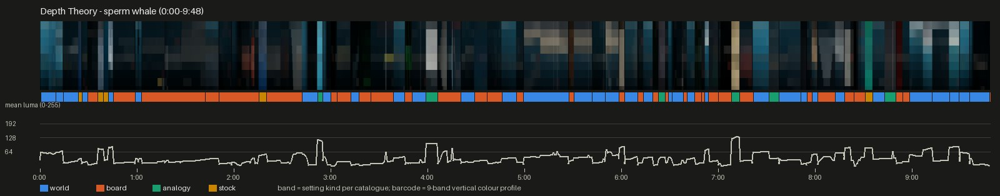
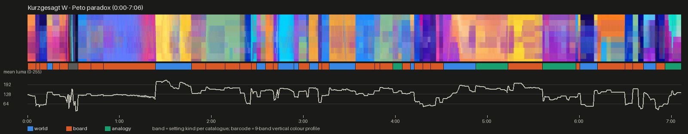
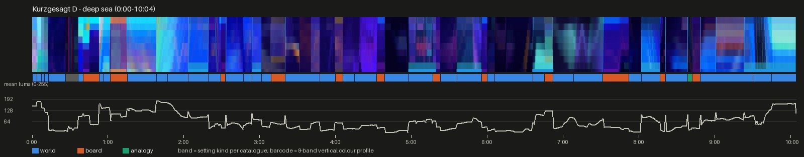
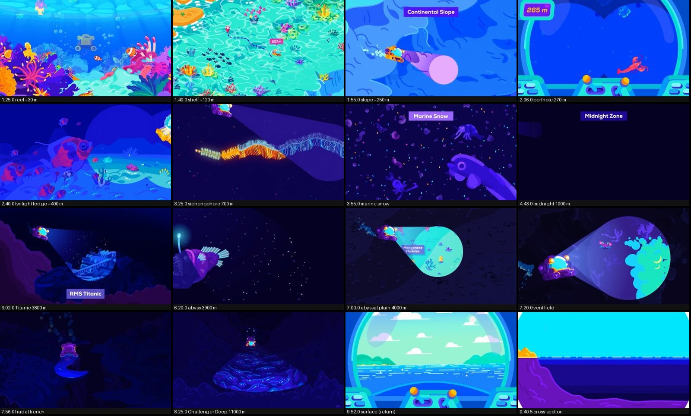
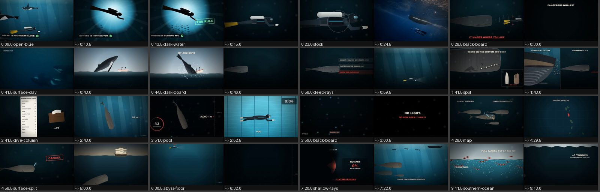
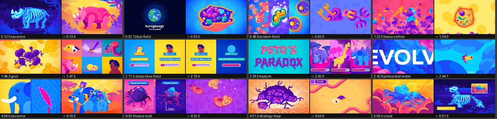
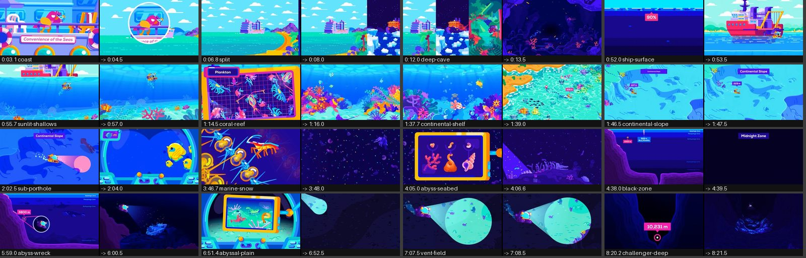

# Reference videos, frame by frame: logical consistency and scenery variety

Internal research for our original 2D explainer channel. It answers the owner's note on orca v2 (FEEDBACK.md, 2026-11-01): every element must make sense for where we are and what the narration says, and the scenery must change with the story instead of one reef under every scene.

We study methods only. Nothing here is a template for copying their characters, assets or compositions (STYLE_BIBLE override and copying rule).

## Sources and method

| Key | Video | Analysed | Frames decoded |
|---|---|---|---|
| **DT** | Depth Theory, "Why You'd Never Want To Meet A Sperm Whale" (`fGcgWaswMns`), our structural reference | 0:00.5–9:47.9 (end card excluded), 587 s | 17,981 at **30 fps** (1080p H.264) |
| **W** | Kurzgesagt, "Why Blue Whales Don't Get Cancer" (`1AElONvi9WQ`), the same file as `study-kurz-bio.md` | 0:00–7:06 minus the channel intro 0:26.4–0:32.9, 420 s | 25,586 at **60 fps** |
| **D** | Kurzgesagt, "The Deep Sea" (`PaErPyEnDvk`), the same file as `study-kurz-bio.md` | 0:00–10:04 minus the intro 0:26.4–0:36.4 (sponsor after 10:04 excluded), 594 s | 40,749 at **60 fps** |

W and D are the two videos in `experiments/kurz-style/study-kurz-bio.md`. Their files were still on the Spark, so they were reused. DT was downloaded again at 1080p30, because the earlier copy was 480p.

**Pipeline** (all on the Spark, CPU only, `CUDA_VISIBLE_DEVICES=""`, `nice -n 10`, 6 ffmpeg threads; the three videos took 30 s, 47 s and 69 s):

1. `tools/frame_metrics.py` decodes **every frame** at its native rate (`-fps_mode passthrough`), downscaled to 192×108. For each frame it records the mean RGB, luma, saturation and chroma-weighted hue, the frame-difference energy `d1` (mean |Δluma|), a colour-histogram distance and a 16×9 layout grid. From these it derives:
   - **hard cuts**: a one-frame layout jump that is at least 3× both neighbours;
   - **flashes**;
   - **gradual transitions**: a full-frame change over 0.6 s with no single dominant frame, timed by its 10–90 % duration;
   - **composition events**: a big layout change over 1 s with no cut or transition, such as a camera move, a layout swap or a large element arriving;
   - **shots**.
2. `tools/grab_frames.py` saves a frame every 0.5 s, the frames on both sides of every cut and transition, and both ends of every composition event: 1,396 + 1,104 + 1,612 frames. `tools/sheets.py grid` lays them out as 43 contact sheets (10×8 tiles = 40 s each, with markers: red = cut, yellow = transition, cyan = composition event).
3. I watched all 43 sheets alongside the timed narration (`tools/vtt_lines.py`) and wrote the **setting catalogue** by hand: `data/{DT,W,D}_settings.csv`, 78 + 47 + 50 rows. Each row records the backdrop rig, the place, the kind (world, board, analogy or stock) and the motivation for the change.
4. `tools/settings_stats.py` joins the catalogue with the detected events and computes setting-versus-shot statistics. `tools/colour_script.py` draws the colour scripts and measures the colour jump at each setting change.
5. For the element audit, 28 stills at 960×540 were checked one element at a time (`sheets/audit_*.jpg`).

**Checks on the detector.** Every red and yellow marker on the 0.5 s sheets was compared by eye with the frames on either side. In DT, every visible cut I found had a marker. Kurzgesagt's apparent "cuts" were checked frame by frame at 60 fps (next point).

> **Correction to `study-kurz-bio.md`.** That study counted "13 hard cuts in W" from 30 fps samples. At the native 60 fps there are **zero one-frame cuts** in the content of either Kurzgesagt video. What looked like cuts are **18-frame (0.30 s) iris and bubble transitions**: a circle of the new scene expands from a point. See `sheets/W_iris_transition_frames_0026.jpg` (W 0:26.4–0:26.7) and `sheets/D_iris_transition_frames_0012.jpg` (D 0:12.4–0:12.7). The 5 hard cuts the detector found in D all fall after 10:04, in the sponsor read.

## 1. Every-frame metrics

| Metric (content only) | DT (30 fps) | W (60 fps) | D (60 fps) |
|---|---|---|---|
| Hard cuts / min | **5.92** | **0** | **0** |
| Gradual transitions / min | 2.35 | 9.43 | 4.75 |
| Transition duration, median (p25–p75) | 0.23 s (0.20–0.42) | 0.35 s (0.25–0.60) | 0.45 s (0.24–0.71) |
| Shot length, median (p25–p75, p90) | 5.8 s (3.5–9.3, 15.1) | 4.7 s (2.6–7.5, 11.7) | 9.7 s (5.8–17.8, 24.2) |
| Composition events without a cut / min | 2.45 | 11.3 | 6.6 |
| Gap between any two visual events, median (p75) | 4.4 s (7.0) | 1.6 s (3.7) | 2.4 s (7.3) |
| Frame-difference energy `d1`, median (p95), 0–255 | 0.23 (2.33) | 0.47 (5.83) | 0.53 (4.74) |
| Frames with `d1` < 0.5 (near-still) | 75 % | 51 % | 49 % |
| Mean luma, p10 / p50 / p90 | 9 / 26 / 65 | 68 / 136 / 173 | 14 / 54 / 133 |

Caveat on the 60 fps numbers: Kurzgesagt often animates on twos, so many alternate frames are holds. The still-frame shares are therefore not comparable between 30 fps and 60 fps sources, while the cut, shot and event numbers are.

**Colour scripts.** In each image, the barcode shows the per-frame vertical colour profile, the band shows the setting kind (world, board, analogy or stock), and the line shows mean luma.





What the curves show:

- **D** is one dive. Luma falls from 150–190 near the surface to under 30 below 1,000 m, and climbs back to about 170 during the ascent. Across 28 world places, scene lightness tracks depth: **Spearman ρ = −0.78** between catalogued depth and CIELAB L\*, p < 10⁻⁶.

  | Depth band | L\* |
  |---|---|
  | Surface and coast | 45–75 |
  | 0–250 m | 55–76 |
  | Twilight, 330–400 m | 24–30 |
  | Midnight, 700–1,000 m | 4–27 |
  | Abyss and hadal | 5–37 (only lamp-lit patches are bright) |

- **DT** sits almost entirely in dark teal, with luma p50 = 26. Its variety comes from short bright spikes: the pool (2:52), the surface and ship scenes (5:00–5:58, 7:58–8:17, 8:58–9:28), the parchment chart (7:08) and stock footage.
- **W** has no "place" palette. Each board takes a saturated flat field colour, and that colour carries the state. One example is the protein field drifting from periwinkle to magenta at "until they don't…" (W 1:12–1:20), with the same set and new colour as things break.

**A setting change is a visible colour event.** The CIEDE76 distance between the mean colour 1 s before and 1 s after each catalogued setting change, compared with random points inside a setting:

| | DT | W | D |
|---|---|---|---|
| ΔE at a setting change, median (p25) | **13.3** (8.5) | **47.6** (26.4) | **22.3** (13.4) |
| ΔE inside a setting, median (p75) | 0.6 (1.3) | 3.2 (10.9) | 1.0 (4.6) |

## 2. Setting catalogue

Full per-row catalogues: `data/DT_settings.csv`, `data/W_settings.csv` and `data/D_settings.csv`, each with start, end, backdrop, place, kind and motivation. Computed statistics: `data/*_settings_stats.json`.

### 2.1 Numbers

| | DT | W | D |
|---|---|---|---|
| Distinct backdrops (world / board / analogy / stock) | 27 (10 / 11 / 6 / 1) | 26 (9 / 15 / 3 / 0) | 27 (24 / 2 / 1 / 0) |
| **Backdrop changes / min** | **7.6** | **6.3** | **4.8** |
| Backdrop hold, median (p25–p75, max) | 6.5 s (4.0–8.8, 39.5) | 6.0 s (5.0–10.5, 34) | 10.0 s (6.0–16.7, 41.5) |
| World-place hold, median (p25–p75) | 6.5 s (4.2–9.2) | 8.0 s (4.7–14.2) | 13.2 s (7.4–17.8) |
| Share of shot changes that also change the backdrop | 70 % | 62 % | 79 % |
| Shots per backdrop hold, median (mean) | 1 (1.40) | 1 (1.58) | 1 (1.29) |
| Setting changes carried by a cut / transition / continuous move | 41 / 16 / 17 | 0 / 42 / 2 | 0 / 37 / 10 |
| Holds that return to a backdrop already used | 48 of 75 | 19 of 45 | 21 of 48 |
| Runtime share: world / board / analogy / stock | 45 / 46 / 6 / 3 % | 27 / 59 / 14 / 0 % | 82 / 17 / 1 / 0 % |
| Most-used backdrop and its runtime share | dark board, 31 % | split panels, 12.5 % | sub porthole, 20 % |

**Reading it.**

- In all three videos, **a shot change usually is a setting change**: 62–79 % of shot changes, with a median of 1 shot per setting hold. Variety inside a setting comes from composition events (camera travel, elements arriving, insets), not from more cuts.
- The settings are a **small reusable kit**: about 27 backdrops per video, and 40–65 % of holds return to a backdrop already used.
  - DT's kit is a dark board for every abstract fact, plus a handful of world rigs: open blue water, dark water, deep water with rays, the surface split-level, the dive column, the menu and the sonar screen.
  - D's kit is the sub porthole, open water at depth, the cross-section and the inset screen.
- In D, the **place changes even when the rig stays the same**. The porthole shows 257 m, 600 m, 1,023 m, 1,200 m, 4,005 m and 8,000 m+, and the depth HUD says so.

### 2.2 DT, how it moves between settings

The full 74-row table is in `data/DT_settings.csv`. These excerpts show the pattern:

| Time | Setting (kind) | Hold | Motivation |
|---|---|---|---|
| 0:00.5 | open ocean, sunlit midwater, diver (world) | 9.3 s | "You're floating in the open ocean" |
| 0:14.4 | same water at a darker grade (world) | 9.5 s | mood shift: "then you feel it" |
| 0:23.9 | stock footage, sperm whale + diver | 2.1 s | "That's a sperm whale" |
| 0:29.4 | black board, "DANGEROUS WHALES?" | 6.5 s | topic shift |
| 0:42.4 | sea surface + boat | 3.0 s | "flipped boats by accident" |
| 0:45.4 → 1:42 | dark board (claims, scale bar, bus, elephants, anatomy) | 13.5 s + 39.5 s | abstract facts |
| 2:42.4 | dive column, 0 → 2,000 m, background darkens with the counter | 9.5 s | "dive more than 2 km down" |
| 2:51.9 | swimming pool (analogy) | 3.0 s | "in a swimming pool" |
| 4:28.9 | map of the Caribbean, Dominica | 8.0 s | narration names Dominica |
| 4:59.4 → 5:58 | surface split-level: Essex 1820, Ann Alexander 1851, whaleboats | 28 s, then reused 3× | "turned it against people" |
| 6:10 → 7:08 | "YOUR OPTIONS" menu board, alternating with one world set per option | 2–6 s each | chapter device |
| 7:21.4 | Dominica shallows with swimmers | 10 s | narration names the place |
| 8:35.5 | longline, captioned "ALASKA · SOUTHERN OCEAN" | 7.5 s | narration names it |
| 9:28.9 | open blue + diver (bookend of 0:00) | 6.5 s | callback to the first line |

DT runs 10 world settings, and **each one appears only when the narration puts us there**. Everything else goes on a neutral dark board, which has no set dressing at all. The board holds 31 % of the runtime by itself.

### 2.3 D, one continuous descent

| Time | Place (depth) | Rig | Motivation (narration) |
|---|---|---|---|
| 0:00–0:12.9 | cruise deck → island → Arctic → jungle triptych | world panels | "remote islands… conquered the Arctic… deepest jungles" |
| 0:52.9 | research ship at the surface | world | "this is where we begin our journey" |
| 0:56.4 | sunlit shallows, 0–50 m | world | "light can still penetrate" |
| **1:15.4–1:38.4** | **coral reef (the only reef in the video: 23 s of 594 s, 3.9 %)** | world | "the seafloor at this depth… covered with coral reefs, algae" |
| 1:38.4 | continental shelf, oblique top-down view; fish and corals thin out | world | "edge of the continental shelf" |
| 1:47.0 | continental slope, bare, darker every second | world | "no more plants… surface of the Moon" |
| 2:03.4 | porthole, 257 → 329 m; reef fish leave, twilight fish arrive | porthole | "enter the twilight zone" |
| 3:20.5 | 700 m, siphonophore | open water | "at around 700 metres… siphonophores" |
| 3:48 | marine-snow field | open water | "marine snow" |
| 4:06 | seabed whale fall, lit only by the sub's lamp | world | dead animal parts feed the deep |
| 4:39.5 | midnight zone, an almost empty black frame | world | "nothing but endless black open water" |
| 6:00 | Titanic wreck, 3,800 m | world | "as deep as the grave of the Titanic" |
| 6:52.5 | abyssal plain; only the lamp cone shows nodules, corals and sponges | world | "manganese nodules… corals and sponges" |
| 7:08 | rift-valley vent field | world | "in the rift valleys… chimneys" |
| 8:21 | Challenger Deep, 11,000 m | world | "the deepest point" |
| 9:30–9:45 | **ascent montage through the porthole**: vent worms → anglerfish → snow → siphonophore + sperm-whale silhouette → jellies → twilight fish → reef fish → the surface | porthole | "we begin our ascent" |

Ten D setting changes are **continuous**: the camera keeps travelling into the next zone, and the scenery thins and darkens under it.



### 2.4 W, a micro world built on boards

W is mostly abstract, with 59 % of the runtime on flat colour-field boards. Real places appear only for animals, and **each animal appears in its own habitat**:

- rhino on savanna;
- hippo, giraffe and elephant each in a habitat panel;
- elephant on savanna with acacias;
- elephant seal on a rocky coast;
- blue whale on a deep-blue field.

The micro "places" are the tissue fields. The backdrop is built from the same cells the story is about.

### 2.5 Setting-change contact sheets

Each pair shows 0.7 s before and 0.7 s after a catalogued setting change. The label names the setting being entered.





## 3. Element logic audit

There are 23 audited shots (28 stills). Codes:

- **N**: named in the narration within the same beat (±5 s).
- **I**: implied by the narration (a category or consequence the line points to).
- **H**: hero or recurring character.
- **B**: biome filler that fits this place and depth.
- **L**: label, HUD or device.
- **X**: decorative and not explained by the place.

Stills: `sheets/audit_DT_a.jpg`, `audit_DT_b.jpg`, `audit_W.jpg`, `audit_D_a.jpg` and `audit_D_b.jpg`.

| # | Shot | Every visible element → why it is there |
|---|---|---|
| A1 | DT 0:08.6, open blue | diver H ("you're floating"); 2 orcas + 1 foreground orca N ("orcas tend to leave divers alone"); dark fin silhouette N (the shark from the line before, "sharks are rare"); light rays and a few soft particles B; check-mark label L. **No floor, no plants, no fish school: open ocean has no bottom in view.** |
| A2 | DT 1:15.5, dark board | sperm whale H; ~16 m bar L; city bus N; elephants N; "40 t = 6–7 elephants" L. The board itself has only dust motes. |
| A3 | DT 1:44, split | humpback head with baleen N; krill cloud N, drawn **only on the humpback half**; sperm whale H; squid tentacles entering at the edge I (foreshadows "squid", which is said 12 s later); labels L. |
| A4 | DT 2:47, dive column | whale diving head-down H; bubble trail I (it just left the surface); depth ruler and counter L; falling streaks plus a few bioluminescent dots at 1,190 m B; background value = depth. |
| A5 | DT 3:21, sonar | squid, fish, rocks and "YOU": all **N**, exactly the narration's list. |
| A6 | DT 5:16, surface split | three-masted whaler N (the Essex); scarred sperm whale H; caption "THE ESSEX · NOVEMBER 1820 · PACIFIC OCEAN" L; dusk sky I (period mood). Nothing else. |
| A7 | DT 6:36, 2 km seafloor | diver with torch N ("dive down and hide"); whale H; total dark B; **lamp, table, plate and fork appear on the word "kitchen"** N. Absurd props are allowed only when the line makes the metaphor. |
| A8 | DT 7:26, Dominica shallows | 3 swimmers N ("permitted swimmers"); boat hull I; two adults + a calf N ("family"); rays B; caption naming the place L. |
| A9 | DT 8:40, longline | line, hooks and hooked fish N; whale stealing N; caption "ALASKA · SOUTHERN OCEAN" L. |
| A10 | DT 9:09, surface/air | CO₂ molecules above the water N; plankton dots below N; surface line I. |
| A11 | W 0:18.5, rhino | rhino I ("large animals"); savanna acacias, grass and hills B (the rhino's habitat); tumours N. |
| A12 | W 2:33, triptych | hippo, giraffe and elephant I ("large animals"); **each panel's backdrop is that species' own habitat** B; cancer bars L. |
| A13 | W 4:10, elephant | elephant N; savanna acacias B; bird scientists with instruments H + I ("researchers aren't sure"). |
| A14 | W 6:11, elephant seal | seal N (on screen as "Elephant Seal"); cliffs, beach and sea B; tiny crabs B; **lifebuoy and sailor cap X**, decorative but plausible coastal flotsam and a joke. |
| A15 | W 2:21, blue whale | whale N; deep-blue tile with specks B: the ocean reduced to one colour. |
| A16 | D 0:11, triptych | Each panel's place is named ("remote islands… the Arctic… deepest jungles") and its contents are that biome's filler. Island: resort, palm and turquoise water B. Arctic: icebergs, ice floes, icebreaker and polar night sky B. Jungle: rainforest, ruins and a jeep B. **No element crosses panels**: no palm on the ice, no ice in the jungle. |
| A17 | D 1:25, reef 0–50 m | corals, anemones and sponges N ("coral reefs, algae"); clownfish and butterflyfish I ("plethora of sea animals"); 2 small jellies and a shrimp B (they live in the shallows); sub H; caustic light B. |
| A18 | D 2:04.5, porthole 257 m | depth HUD L; yellow reef fish leaving B (the last shallow species); red shrimp B; flat mid-blue water, **no corals**. |
| A19 | D 3:27, 700 m | siphonophore N; sub H (the only light source); indigo water with sparse particles B. Nothing else. |
| A20 | D 4:10, seabed | whale-fall skeleton with scavengers I ("dead plant or animal parts"); sea pens and sponges B; marine snow N; faint jelly silhouettes far back B (low contrast, background scale); lamp cone H. |
| A21 | D 7:05, abyssal plain | only what the lamp lights: manganese nodules N, deep-sea corals and sponges anchored on them N. The rest of the frame is dark mud. |
| A22 | D 8:55, Challenger Deep | sub H; sea cucumbers N; amphipods N; pale floor and dark trench walls B. |
| A23 | D 9:33–9:43, ascent | vent worms → anglerfish + amphipod → snow → siphonophore + a sperm-whale silhouette → jellies + twilight fish → reef fish + kelp, all I (each was named earlier in its own zone, and "we begin our ascent" recalls them). **Every creature reappears at its own depth band, in order.** |

**Tally over the 23 shots.**

- 124 visible elements, counted one per row entry:
  - 36 named (N, 29 %);
  - 24 implied (I, 19 %);
  - 12 hero or recurring (H, 10 %);
  - 39 biome filler (B, 31 %);
  - 11 labels and HUD (L, 9 %).
- 2 elements are decorative and unexplained (X, 1.6 %), both in one shot: W's lifebuoy and sailor cap.
- **0 elements belong to another biome or depth.**

**How they keep it believable.**

1. **Biome filler is low contrast, background scale and native**: far jellies in D 4:10, rays and particles in DT, sea pens on the seabed. Filler never competes with the named subject.
2. **Set-dressing density follows the place.**
   - D's reef is dense, with dozens of coral, plant and fish shapes.
   - The shelf is sparse, the slope is bare, and the midnight zone holds a single subject.
   - The abyss shows only what a lamp lights.
3. **Light is diegetic below the photic zone.** Below about 200 m everything outside a lamp cone or a bioluminescent source drops to the background colour (D 4:10, 6:52, 4:45). DT does the same with the diver's torch (6:36, 7:51).
4. **Scale is anchored to a named comparator**: bus and elephants (DT), a "30 cm" ruler beside the vampire squid (D 5:05), the sub beside a 30 cm amphipod (D 9:01).
5. **Era and place props are captioned**: the Essex with date and ocean, the "ALASKA · SOUTHERN OCEAN" caption, the Dominica map, depth pins on the cross-section.
6. **Abstract content gets an empty board.** A whale beside a bus on a dark void cannot be illogical, because there is no environment to contradict.

## 4. Takeaway rules for a code-generated video

Measured ranges come from §1–§3. "Shorts" scaling assumes our ~60–90 s vertical format, where the visual-change cadence of FEEDBACK B5 (2.5–4.5 s) already applies.

### Scenery variety

1. **Setting = place, and the narration sets the place.** Each storyboard scene declares `place` (biome + depth or altitude + era) and `kind` ∈ {world, board, analogy}.
   - A world place is allowed only if the scene's narration, or the beat just before it, names or implies it. In the catalogues, every world setting in DT and D has such a motivation.
   - Abstract facts, numbers and comparisons go on a **board**.
2. **Change the setting with the story.** Target **5–8 backdrop changes per minute** (measured 4.8 / 6.3 / 7.6).
   - Hold a world place for a median of **6–13 s** (p25 ≈ 4 s, p75 ≈ 9–18 s), and a board for **4–9 s**.
   - Never use the same backdrop for more than **40 s** in a row (measured max 34–41.5 s). For an 85 s Short, that means **at least 8 setting holds**. Orca v2 had 1.
3. **Usually change setting when you change shot.** Make **60–80 %** of shot changes setting changes. Inside a setting, make the visual change through composition (camera travel, an arriving element, an inset), at **2.5–11 composition events per minute**, so that the gap between any two visual events stays at a median of **1.6–4.4 s**.
4. **Use a small kit and revisit it.** The 10-minute references use about 27 backdrops each. A 60–90 s Short needs **6–12 rigs**: one neutral board, a list card, a cross-section or map, a HUD frame (porthole or sonar), and 4–8 world places.
   - Returning to a rig is fine (refs: 40–65 % of holds are returns).
   - When a rig returns, change the place shown inside it (the depth counter, the caption).
5. **A setting change must show.** The mean-colour CIEDE76 between 1 s before and 1 s after a setting change should be **≥ 10** (refs median 13–48; inside a setting 0.6–3). If a wipe replaces a picture with a near-identical one, the setting did not change.
6. **Lightness follows depth** (D, ρ = −0.78):

   | Depth | Target L\* |
   |---|---|
   | Surface or air | 45–75 |
   | 0–200 m | 55–75 |
   | 200–1,000 m | 20–30 |
   | Below 1,000 m | 4–25, with light only from lamps or bioluminescence |

   A descent should darken continuously. A depth device (counter, cross-section pin or HUD) appears whenever the depth changes.
7. **Grammar of transitions: pick one per episode.**
   - Kurzgesagt grammar: **0 hard cuts**, 0.25–0.7 s iris, bubble or wipe transitions (median 0.35–0.45 s), and continuous camera travel for about 20 % of setting changes.
   - DT grammar: hard cuts at about 6 per minute, plus 0.2–0.4 s fast transitions.
   - Analogy settings (pool, room full of eyes, parchment chart) take ≤ 6–14 % of the runtime. Each one opens on a "like / as / that's like" line and returns to the real place afterwards.
8. **Bookend with the opening setting** (DT 0:00 ↔ 9:29; D 0:36 ↔ 9:45). When retracing a journey, revisit the places in reverse order (D ascent).

### Logical consistency (what may be on screen)

9. **Element whitelist per scene.** An element may appear only if it is one of:
   - (a) named in the narration of this scene or the one before;
   - (b) the episode's hero or recurring character;
   - (c) from the **biome list of this scene's place and depth**, as background filler at ≤ 1/4 of the subject's on-screen size and at reduced contrast;
   - (d) a label or HUD.

   The measured shares are about 67 % in classes (a), (b) or (d) (counting implied elements as named), 31 % in (c), 1.6 % unexplained, and **0 % from another biome**.
10. **Set dressing comes from a per-biome list**, and its density falls with depth.
    - These lists are drawn from what the references actually show. Extend them by the same rule, with a source, for new places.

      | Biome | Allowed set dressing |
      |---|---|
      | Sunlit shallows / tropical coast (0–50 m) | caustics, rays, coral, anemones, sponges, kelp or seagrass, reef fish, small jellies, shrimp, crabs |
      | Open-ocean midwater (sunlit) | rays and sparse particles **only**; no floor and no plants |
      | Shelf and slope (50–300 m) | sand and rock; sparse coral only at the shallow edge; thinning schools; no plants past about 200 m |
      | Twilight (200–1,000 m) | blue → indigo water; lanternfish or hatchetfish schools; jellies; shrimp; siphonophores; bioluminescent dots |
      | Midnight (1,000–4,000 m) | near-black water, marine snow, light only from a source; anglerfish, viperfish, vampire squid, giant squid, sperm whale |
      | Abyssal floor | grey mud, manganese nodules, sea cucumbers, urchins, sponges, deep corals, whale falls; vents only where a rift is named |
      | Hadal | black rocks, snailfish, amphipods, sea cucumbers |
      | Polar sea (D 0:08 Arctic panel) | ice floes, icebergs, dark polar sky, icebreaker or ship; **no palms, coral or tropical fish** |
      | Surface / air | horizon, sky colour for the time and era, ships of the narrated era (captioned) |

    - Coral reef is used **only** when the narration says reef, coral or a shallow tropical coast. It filled 3.9 % of D's runtime and 0 % of DT's.
11. **Animals live where they live.** Each species carries a habitat range (biomes + depth). The renderer must refuse to place a species outside its range unless the narration explicitly moves it there.
    - W puts every animal in its own habitat panel, and D's ascent reorders all creatures by depth.
    - Orca v2 broke this rule: jellyfish and background sharks drifted beside a pod hunt, and tropical coral sat before an Antarctic beat.
12. **Visibility is diegetic in the dark.** Below 200 m, anything outside a lamp cone or a light-emitting organ renders at background colour (silhouette) or not at all.
13. **Abstract beats get an empty board**: a flat field with only the compared items and labels. Boards may take **17–59 %** of the runtime. Board backgrounds carry no creatures or props unless those are being compared.
14. **Absurd or joke props only on the word.** They are allowed when the narration makes the metaphor, they appear on that word, and they leave with the beat: DT's kitchen table (6:36), receipt (2:34) and "official complaint" (5:58).
15. **Caption the place and time** whenever a real location or date is named: map card, depth pin or caption plate, as in DT (Essex 1820, Dominica, Alaska · Southern Ocean) and D (zone labels, depth HUD).

### Checks a script can run on our renders

- With `tools/frame_metrics.py` and `settings_stats.py` on our video plus our storyboard's scene places:
  - backdrop changes per minute ≥ 5;
  - longest same-backdrop run ≤ 40 s;
  - share of shot changes that are setting changes ≥ 0.6;
  - gap between visual events, median ≤ 4.5 s.
- With `colour_script.py`:
  - ΔE at each declared setting change ≥ 10;
  - for underwater scenes, L\* within the depth band of rule 6.
- From the storyboard JSON (no frames needed):
  - every element on screen ∈ narration-named ∪ hero ∪ `BIOME[place]` ∪ labels;
  - every species inside its habitat range;
  - reef only where the narration says reef.

## 5. Files and how to rerun

| Path | What |
|---|---|
| `tools/frame_metrics.py` | every-frame metrics, cut, transition and composition detection → `<key>.npz`, `<key>_events.json` |
| `tools/grab_frames.py` | one-pass frame export: every 0.5 s, cut boundaries, event ends, `--times` |
| `tools/sheets.py` | `grid` (0.5 s sheets with markers), `pairs` (before/after), `stills` (labelled stills); all ≤ 1600 px wide |
| `tools/vtt_lines.py` | YouTube .vtt → timed narration lines |
| `tools/settings_stats.py` | setting catalogue + events → setting-versus-shot statistics |
| `tools/colour_script.py` | colour-script image + ΔE at setting changes + L\*/C\* by kind |
| `tools/run_spark.sh` | runs all of the above for one video on the Spark |
| `data/{DT,W,D}_settings.csv` | hand catalogues (start, end, backdrop, place, kind, motivation) |
| `data/{DT,W,D}_events.json`, `*_settings_stats.json`, `*_colour.json` | measured outputs |
| `sheets/` | colour scripts, setting-change pairs, D depth ladder, iris-transition frame bursts, element-audit stills |

The 43 every-0.5 s review sheets (about 12 MB) were not committed. They are on the Spark at `~/studio/refs/frame-analysis/sheets/{DT,W,D}_half_*.jpg` and can be rebuilt with `run_spark.sh`.

To analyse one of our videos:

```
scp out/<ep>.mp4 dgx-spark:studio/refs/frame-analysis/
ssh dgx-spark 'cd ~/studio/refs/frame-analysis && tools/run_spark.sh <ep>.mp4 OURS'
# watch sheets/OURS_half_*.jpg, write OURS_settings.csv (same columns), then:
ssh dgx-spark 'cd ~/studio/refs/frame-analysis && tools/run_spark.sh <ep>.mp4 OURS OURS_settings.csv 0 0'
```

The parallel audit of our orca v2 (`ORCA_V2_AUDIT.md`) used the same `frame_metrics.py`, so its numbers line up with this file. It quotes early reference numbers that included intros and sponsor reads. Use the content-only numbers in §1–§2 here.
